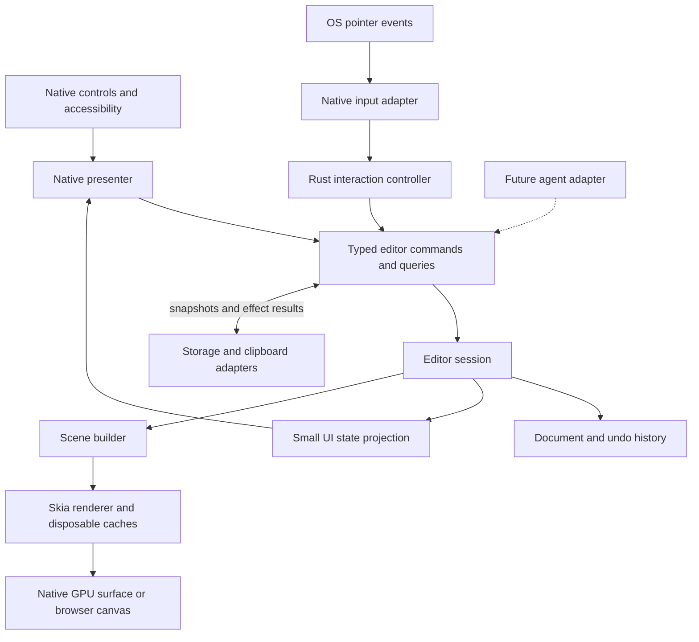

# Native Sketch architecture

Accepted direction, consolidated 2026-10-15. This is the target, not a claim that the
refactor or production Skia integration is implemented. Starting code: `712059d5`
(`codex/github-pages`, selected by the owner; comparison-results branch excluded);
PR #1 architecture audit: `de46c2f`.

## Decisions and reading map

- Skia is selected for native editors and CanvasKit for web; native controls stay native.
- Rust owns drawing/document/editing semantics and shared tool/action definitions.
- Maximum 200 physical lines per handwritten source file, including tests/scripts.
- Node.js ES modules replace owned shell/PowerShell and routine orchestration.
- Define typed commands/queries for future agents; agent transport is deferred.
- macOS first, iPad/iPhone next; other hosts are individually scheduled milestones.

| Document | Purpose |
| --- | --- |
| [Contracts](architecture/contracts.md) | Types, patterns, transactions, FFI, module map |
| [Runtime](architecture/runtime.md) | Ownership, threads, platform scheduling |
| [Storage contracts](architecture/021-storage-contracts.md) | Exact save snapshots, bounded workers, diagnostics and local recovery policy |
| [Rendering](architecture/rendering.md) | Skia, caches, infinite canvas, latency |
| [Invariants](architecture/invariants.md) | Rules, enforcement and acceptance cases |
| [Quality](quality.md) | Required gates and current versus planned checks |
| [Coverage](quality/coverage.md) | Feature registry and executable evidence |
| [Platform checks](quality/platforms.md) | E2E, diagnostics and hardware limits |
| [Tooling](quality/tooling.md) | Languages, Node migration, tool versions |
| [Reliability](quality/reliability.md) | Diagnostics, recovery and packaging |
| [Refactoring plan](refactoring-plan.md) | Implementation tasks and completion |
| [Prototype baseline](architecture/prototype-baseline.md) | Implemented boundaries at the selected base |

## Dependencies

The owner-selected [typed bindings migration](architecture/022-typed-bindings-migration.md)
replaces custom command packets with typed native FFI/generated declarations and a typed
Wasm binding. Existing consumers migrate incrementally; shared Rust commands and document
encoding remain authoritative. Read the migration plan before following older 022 layouts.

Core depends on validated values and pure geometry, not native UI, Skia, file dialogs or
transport implementations. Bridges are the only native FFI callers. Rendering reads
immutable scene data; it cannot mutate the document. Storage returns correlated results.
Canvas composes surface/focus/layout, input and scheduling; it does not read tool widgets.

## State ownership

| State | Authority | Persistence |
| --- | --- | --- |
| Strokes, styles, stable IDs | Rust Document | Versioned document format |
| Tool, brush, selection, interaction, history | Rust EditorSession | Explicit session policy, not incidental document data |
| Camera/viewport | Per-view instance, shared Rust math | Not an edit or undo entry |
| Focus, dialogs, incomplete field text | Native host | Presentation lifecycle |
| Paths/textures/tiles | Geometry/renderer owners | Disposable, never authoritative |
| Save request | Immutable snapshot + session/revision | Acknowledge only confirmed persistence |

Windows must not accidentally share a camera. Multiple views editing one document need
an explicit document owner/history policy, not independently mutable handles to one model.

## Native presentation

| Platform | UI and capabilities |
| --- | --- |
| macOS | Swift/AppKit controls, custom Skia canvas; SwiftUI when behavior is preserved |
| iPhone/iPad | Swift/UIKit, touch-oriented native layout; SwiftUI where appropriate |
| visionOS | Native 2D window editor; immersive/spatial work deferred |
| tvOS | Native view-only interface and remote focus navigation |
| watchOS | Standalone viewer, cached-first display, optional iPhone/network adapters |
| Android | Kotlin/Android Views and Material controls |
| Windows | C#/WinUI 3 controls |
| Linux | Rust/GTK4/libadwaita; GNOME-first validation |
| Web | TypeScript/semantic HTML, Rust/Wasm editor, CanvasKit |
| ChromeOS/Googlebook | Android and/or browser distribution, no separate document engine |

Use native Apple appearance including Liquid Glass where supported, with legible older-OS
fallbacks. Preserve focus, contrast and touch targets. Do not build a shared widget tree.

## Viewers and document sources

Enforce read-only capability in Rust and the native ViewerSession facade, not only hidden
buttons. Validate candidates before replacing displayed content. Watch launches independently:
show validated cache, prefer iPhone on explicit refresh within the existing bounded deadline,
then use a configured server for the same published identity. Phone-only copies have no
invented cloud fallback. Compare revision/parent, server generation and hash, not timestamps.
Reject late callbacks, corrupt/oversized input and identity mismatches. Stage changed content
during navigation. Preserve [current source behavior](../apps/watchos/SOURCES.md); production
network/auth remains task 014. Queued transfer does not mean displayed or saved.

## Baseline and open decisions

PR #1 has 12 audited source files over 200 lines and mixed input/UI/document duties.
Inventory the selected base rather than importing comparison tooling. Preserve ABI 2, Wasm protocol 1, document
bytes and history behavior during extraction. Native painters remain prototypes.
The [Skia decision](decisions/0003-skia-and-quality-architecture.md) supersedes open selection
in historical proposals; preserve evidence and its limits. Physical pen-to-screen measurement
awaits a suitable camera; Cintiq software results are not physical latency measurements.
Minimum OS/device matrix, absolute budgets, signing/distribution, production network auth
and recovery retention remain explicit task decisions.
