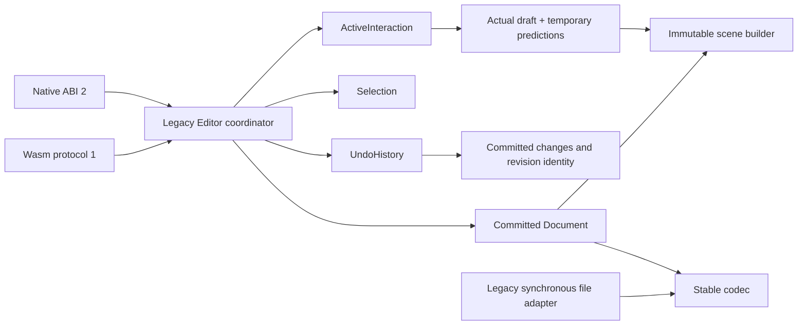

# Task 018: Rust extraction, phase A

Starting revision: `8ae87622dc26bf7f6b5cd183c20ebc6527f88b62`, descended from the selected
`codex/github-pages` base. This phase preserves existing public behavior; the additive
typed session façade and Rust read-only capability enforcement are a separate phase B.
Task 017 native E2E remains blocked by the execution/console session mismatch. This work
is authorized local preparation, not acceptance of the complete refactor.

## Implemented ownership

All paths below are relative to their existing crate's `src/`; no crate dependency was
added. Every handwritten Rust source and test in these three crates is at most 200 physical
lines after rustfmt. Six unrelated native/web source violations remain migration debt.

| Crate / files | Responsibility and ownership |
| --- | --- |
| core `lib.rs`, `error.rs` | Compatibility reexports, existing error/status categories and limits |
| core `model/{document,sample,style,transform}.rs` | Original public values and validation; committed samples only |
| core `application/editor.rs` | Small legacy `Editor` coordinator; exclusive `&mut self` mutation |
| core `application/{selection,state}.rs` | Session selection and immutable legacy view projection |
| core `application/document.rs` | Cohesive synchronous compatibility persistence methods and validated replacement |
| core `interaction/{controller,ink,batch,transform}.rs` | One `Idle / Drawing / Transforming` enum, captured brush, actual/predicted separation, whole-batch validation, transform preview |
| core `history/mod.rs` | Committed change records, undo/redo, revision and saved-revision identity |
| core `geometry/{bounds,hit_test,outline}.rs` | Pure calculations with immutable model inputs |
| core `scene/{mod,builder}.rs` | Renderer-neutral owned path commands; document/transient read-only projection |
| core `persistence/{codec,reader,file_store}.rs` | Unchanged bytes/validation; bounded decoding and separate legacy synchronous file adapter |
| core `source_policy/{version,comparison}.rs` | Immutable metadata validation and comparison; no transport |
| ffi `types.rs`, `handles.rs`, `status.rs` | Unchanged C layouts, unique handle, panic containment and numeric errors |
| ffi `input.rs`, `editing.rs`, `state.rs`, `scene.rs`, `document.rs`, `source.rs` | Focused borrowed-input/caller-output adapters with original exported symbols |
| wasm `registry.rs`, `handles.rs`, `buffers.rs` | Original instance-local handle/token registry and memory lifetimes |
| wasm `reader.rs`, `dispatch.rs`, `encoding.rs`, `command.rs` | Original request validation, operation dispatch, output encoding and panic/trap contract |

## Preservation rules

The public model fields, `Editor` method signatures and root Rust exports remain available.
The C header, ABI version 2, raw Wasm protocol version 1 and fixed document fixtures are
unchanged. The adapters retain their input/output ownership, status codes and panic handling.
No new native symbols, asynchronous services, locks, caches or render dependencies exist.

The enum excludes simultaneous ink/resize state without changing reachable transitions.
Invalid calls preserve the active transaction. Actual IDs/timestamps and corrections keep
the original validation order; corrections still cannot target an actual sample first
introduced in the same batch. Successful empty batches still clear predictions. History
records only committed edits; no-op transforms and cancellation leave history untouched.
New/import retain editor-local revision monotonicity and reset selection/history.

One owner holds each editor; native callers must serialize handle access as before. Inputs
are borrowed only during calls, outputs retain their original caller-owned or token-owned
lifetimes. Core remains `forbid(unsafe_code)` and receives no platform/GPU objects.
The legacy save/load methods still perform synchronous I/O; task 021 introduces immutable
worker snapshots and destination ordering. These methods must not be mistaken for a new
nonblocking ink-path architecture.

## Tests and traceability

All 32 existing tests remain. Split internal tests now use behavior modules; current feature
mappings migrate to actual Cargo-discovered names. Historical baseline discoveries and
frozen fixture bytes are retained without modification. Private history-length assertions
were replaced by committed byte/revision equality plus observable undo exhaustion.

Three new deterministic tests in `tests/properties.rs` add:

- INPUT-002, INK-002, UNDO-001: 64 generated sample sequences, five batch sizes, absent
  pressure, predictions, identical committed bytes, exactly one undo/redo operation.
- INPUT-001, INK-001, UNDO-002: invalid trailing coordinate/pressure/ID/time samples retain
  both preview and committed content, active undo rejects, cancellation preserves history.
- INK-003 and INK-002: changed caller brush settings affect only the next stroke; an empty
  successful append removes predictions without discarding actual samples.

This is deterministic property coverage, not exhaustive fuzzing or native pen delivery.
Compatibility tests also retain invalid import, correction identity, failure during file
replacement, fixed ABI capacity/layout, source ordering and caught-panic cases.

## Verification and outstanding scope

Required checks: `cargo fmt --all -- --check`, strict workspace Clippy, all 35 Cargo tests,
`node scripts/check.mjs`, `node scripts/check.mjs --platform web`,
`node scripts/check.mjs --platform wasm` (real native/Wasm conformance and 20 frozen
protocol pairs), and scoped evidence gate for COMPAT-001 through
COMPAT-005 plus INK-003. Evidence output records exact source/diff and binary identities;
the lead records the frozen commit and independent review outcome before integration.

The host initially lacked `wasm32-unknown-unknown` for pinned Rust 1.99.0; installing that
required target enables the real checks. Native Swift build requires execution outside the
nested sandbox, as in prior verification. These setup failures are not test passes.
Native UI/physical pen tests, other OS ABI execution and platform E2E remain unexecuted here.
Phase A does not enforce viewer capabilities, provide session/request save tokens, install
structured runtime logging, or finish task 018's typed command façade. Those claims require
phase B and the separately ordered storage/native/rendering work.
