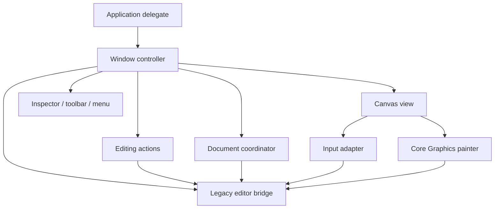

# macOS composition: first extraction

This tranche preserves ABI 2, synchronous file operations, current settings and the
provisional Core Graphics painter. It does not claim completion of task 019. Typed
session adoption and asynchronous persistence depend on the additive 021 bridge.

All components run on the main actor. The window controller owns the editor and its
native components; component back-references are unowned. The canvas owns its input
adapter and painter. The legacy bridge destroys its editor handle exactly once.

| Component | Responsibility |
| --- | --- |
| Application delegate / entrypoint | Process lifecycle and composition |
| EditorWindowController | Window, layout, focus and presentation refresh |
| BrushInspectorController | Native controls, formatter, incomplete field text |
| EditorToolbarController | Native toolbar construction |
| EditorMenuController | Menu definitions, routing and validation |
| EditorActions | Native editing actions and field-editor undo precedence |
| CanvasView | Native surface, viewport and event forwarding |
| AppKitInputAdapter | Explicit native gesture state and mouse/tablet sample conversion |
| CoreGraphicsPainter | Existing temporary painter and selection overlay |
| DocumentCoordinator | Existing file panels, save binding and replacement policy |
| EngineFailurePresenter | Native engine/file error presentation |
| LegacyEditorBridge | Unique legacy Rust handle and borrowed/output conversions |
| NativeSmokeJourney | Injected event regression, separate from real UI automation |

Remaining migration seams are explicit: input still reads inspector settings, view
state refresh remains in the window controller, and legacy FFI operations remain in
native adapters. Replace these together with the typed Rust session bridge; do not
create another Swift copy of domain state. Rendering and common viewport math are
separate tasks. No new batching, threading, pressure capability or latency claim is
introduced by extraction.

Preserve cancellation before existing coordinate remaps, text-field first-responder
undo/redo, unsigned mouse pressure absence, and the existing save/error semantics.
Mechanical extraction and the independently verified shortcut repair are separate
commits so behavioral changes remain reviewable.
