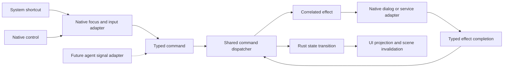

# macOS typed-session integration contract

Agreed implementation boundary after reviewed task 021 services. The concrete
[native v1 declarations](019bc-native-interface.md) are frozen at `106abfe` (integrated
as `c0b63da`). Implementation and native caller adoption are in progress; declarations
alone are not executable evidence. The existing ABI 2 and Wasm 1 stay intact.
The initial native extraction remains a compatibility step; it must not create another
Swift authority for brush, tool, document, history or saved revision.

## Ownership and interface direction

- `ApplicationSession` composes `EditorSession` and semantic file/navigation effect state.
  All adapters enter its typed command dispatcher. `NativeRuntime` composes the process-wide
  save coordinator, ordered bounded read/write service, destination/event registries,
  recovery scheduling and diagnostics. The FFI validates C values and ownership; it does
  not implement another set of editing or file rules.
- An additive, independently versioned `sketch-native-ffi` C session interface wraps
  `ApplicationSession` and the services runtime. Swift imports only `CSketchSession`, whose
  include graph cannot expose legacy entry points. Legacy `SketchEditor` symbols and numeric
  statuses remain in the separate `sketch-ffi` crate with their existing semantics.
- One Swift `@MainActor` bridge owns each session handle and frees it once. All session
  calls, including destruction, occur on that owner. Worker code never receives the handle.
- One application-owned service bridge owns the process-wide save coordinator and bounded
  storage worker. Windows submit owned snapshots and receive correlated results. A window
  closing does not permit an active writer to be forgotten or a newer writer to overtake it.
- New headers are cohesive (session values/commands, owned query results, services), each
  at most 200 physical lines. Keep stable integer fields and explicit lengths; no Swift,
  AppKit, Rust enums, `usize` identities or borrowed asynchronous pointers cross the ABI.
- Every fallible entry contains panics and returns a defined status. A caught mutation
  panic poisons the relevant handle; no further mutation is allowed. Resource destruction
  remains supported. Pointer validity and unique ownership are caller preconditions.

## Commands and projections

The owner reaffirmed the source-independent command boundary during implementation:

Shortcuts and controls must not contain separate editing implementations. An adapter
translates the signal into a semantic command; the dispatcher validates capabilities,
session/interaction identity and state before executing it. Future agent requests enter
that same command boundary, without keyboard simulation or direct state mutation.
Native text editing consumes its own shortcuts before application-command routing.

Save As is one semantic intent regardless of source. Its native chooser is an effect
used when a destination is needed; a future adapter may supply a valid destination grant.
Both routes converge on the same typed save admission and completion handling. Menu
selectors, toolbar actions and future agent adapters must not each implement persistence.
No future agent transport, authentication or automatic file grant is introduced now.

Use typed wrapper methods over named C functions or a validated tagged command record;
never deserialize arbitrary Swift objects into domain commands. Raw enum tags and numeric
values are validated before mutation. Context contains session, request and interaction
identities; stale input must fail even if a pointer ID or document revision repeats.

A small projection supplies Rust tool/brush, capabilities, dirty/revision/session,
interaction and action availability. This projection is O(1); selected geometry, scene
and committed snapshots remain explicit potentially expensive queries. A presenter updates
native controls from the projection. Incomplete field text belongs to the native field;
validated commits send `SetBrush`. The canvas input adapter reads the shared projection,
never inspector widgets. Native text undo, selection, deletion and shortcuts retain first
responder precedence. Explicit native actions may cancel an active transaction before
requesting a state change; the bridge must not silently cancel on every command.
Unrelated projection refreshes must not overwrite an active field editor's incomplete text.
Before a gesture moves focus to canvas, native end-editing validation must succeed; rejected
text retains field focus and must not start ink with a silently different brush setting.

## Save and completion ownership

The native file panel supplies a private access grant and copied location descriptor;
the worker resolves the canonical destination identity without filesystem work on the UI owner.
The application service retains that grant until its terminal receipt is drained, including
after a window closes. Existing-file aliases and nonexistent-file identity use one documented
native resolver: resolve the existing parent identity plus the proposed leaf for new files;
reconcile identity after replacement. A globally serial worker remains the final ordering
guarantee even when two grants were assigned different identities for one destination.
The native adapter retains the grant and supplies a bounded copied descriptor. Filesystem
validation/canonicalization and `DestinationAccess` construction run on the worker, not the
UI owner. An issued terminal event releases the retained grant. Reads share accepted ordering
with writes: Open must not overtake an accepted Save and observe obsolete bytes.
Snapshot admission runs on the session owner, outside pen callbacks, with capacity reserved
before copying. For a newly chosen destination it captures the current committed revision
at resolved admission, not the earlier panel click. Readiness defers while a newer stroke
is active and is retried in a later owner turn. An unresolved runtime barrier rejects later
I/O admissions as Busy before mutation, across windows; editing stays available. The service worker owns encoding
and staged writes; Swift never serializes a document or marks it clean independently.

An issued completion is consumed once. Its session, revision, destination, binding generation
and sequence come from the coordinator, not caller-supplied claims of a successful write.
Native polling is nonblocking and bounded. Route results by session identity, acknowledge
on the mutation owner, then refresh the projection. A stale or closed window does not show
an obsolete failure panel. A completion can still represent an actual disk write after
cancellation; retain that outcome rather than assuming cancellation undid it.
Use one app-owned callback source while jobs are outstanding, with a fixed maximum receipt
count and time budget per turn; reschedule remaining receipts on a subsequent main-loop turn.
Do not poll per input sample or leave a continuous polling timer when storage is idle.

Save As adopts the new destination only after confirmed success and Rust acknowledgement.
Ordinary Save continues to use the old binding while Save As is pending. Do not dispatch
another Save As for that session until its completion is consumed. No native URL change
may run ahead of this domain result. Error sheets offer a deliberate retry/new destination
without dropping edits or reusing an already-consumed completion.
The window title continues to identify the old destination until confirmed adoption.

## Open, recovery and navigation

A bounded reader produces a fully validated owned candidate off the UI thread. Its request
captures the previous session plus a native navigation generation. On the owner, reject
obsolete candidates before replacement; do not bind a delayed read to the current document.
Prepare a complete replacement with its binding before installation; validate the issued
read against session, navigation generation and the content revision authorized for replacement.
Installation is atomic with no fallible post-replacement bind. Keep the previous document on
validation/read failure or newer edits, and preserve current valid tool/brush settings.
Reserve bounded retirement capacity before swapping a large document; its destruction must
not occur in a pen callback.

Recovery uses the separate recovered-copy constructor: editable, dirty, no destination,
new session identity. Never call normal load binding for a recovered copy. Explicit discard
and candidate retention remain service operations; opening a recovered copy does not imply
that its only recovery generation may be deleted immediately.

Close/new/open/quit use a Rust semantic navigation state machine and native asynchronous sheets.
Swift owns presentation and platform lifecycle responses, never a duplicate dirty/save decision.
Pending
writes settle without UI waits; cancellation can cancel navigation while retaining the open
document. Recheck dirty state after completion because newer edits can exist. Deferred app
termination must finish or deliberately cancel this workflow rather than blocking the main
thread or freeing a live session behind callbacks.
Track one navigation intent at a time. Every `.terminateLater` response receives exactly one
`reply(toApplicationShouldTerminate:)`, including cancellation and service failure paths.

## Acceptance before replacing legacy consumers

- C/Rust layout and failure/capacity/ownership tests; Swift bridge tests; ABI 2/Wasm 1 fixtures.
- Stale session/interaction/read/completion rejection and teardown with pending work.
- Brush controls project Rust state; drawing captures committed settings, predictions stay
  temporary, cancel preserves history and a stroke is one undo operation.
- Real native Save/Save As shortcuts and text-field shortcuts, with visible canvas and file
  assertions; core/bridge tests alone do not certify native event delivery.
- Actual save failures, delayed completion during edits/navigation, recovered dirty/unbound
  copies, and bounded queue/log behavior. Keep physical pen latency pending a camera.

## Agreed implementation stages

Rust and macOS owners agreed this direction before implementation. Keep staged delivery explicit:

| Stage | Owner and outcome | Gate before adoption |
| --- | --- | --- |
| 019A | Rust portable `ApplicationSession`, typed commands/effects, navigation and prepared replacement | Rejection/ownership/identity/revision tests and fresh review |
| 019B | Rust additive `sketch_session_v1_*`, projection/input/owned scene C interface | Layout, capacity, panic/ownership tests and a real Swift consumer; ABI 2/Wasm 1 unchanged |
| 019C | Rust `sketch_runtime_v1_*`, bounded ordered read/write events and destination continuation | Failure, stale read, ordering, receipt/grant lifecycle and shutdown tests |
| 019D | Swift bridge, presenters and unified native command adapter | Controls/canvas use Rust projection; native validation precedes dispatch |
| 019E | Native async sheets, recovery and deferred close/quit | Actual native journeys, designer assessment and fresh review |

Command families are edit, input batch, file intent, issued effect reply and issued service
result. Separate borrowed-input C functions construct the same command route. Effects include
destination/source choice, unsaved-change confirmation, awaiting writes, queued operations,
navigation readiness and failure presentation. Cancellation is a valid typed reply, not a
storage failure. Unknown or reused effect identities cannot authorize a state change.

Opaque runtime/session/scene handles use explicit release; C values use fixed-width tags,
lengths and reserved fields. Versioned function families cover creation, dispatch, input,
projection/action availability, owned scene copy, bounded polling, issued-event apply/discard,
session detach and asynchronous shutdown. A scene snapshot carries session/revision/generation
and avoids rebuilding between count and copy. Constructors initialize output handles to null;
other failure paths leave outputs unchanged except documented count/initialization outputs.

One writer owns shared interface changes. Freeze the actual C declarations before Swift
implementation; speculative native symbols or no-op commands do not count as adopted behavior.
This phase does not change the temporary Core Graphics painter; production Skia follows task 020.
