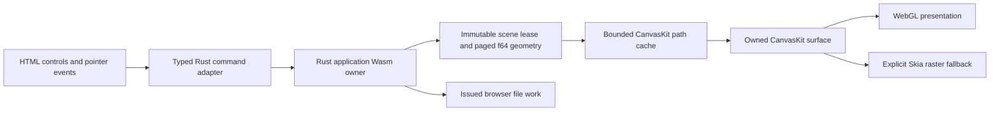

# Browser Skia integration after portable-command adoption

Implementation handoff for the authorized Skia migration, following
[the portable browser adapter](022-web-portable-adoption.md). This is a design and API
probe, with the first production implementation and scoped checks now recorded in
[browser Skia evidence](../evidence/020-web-canvaskit.md). Keep the existing semantic HTML controls,
Rust commands, document format and input behavior. No new drawing feature is introduced.

## Dependency and layer boundary

Use the published `canvaskit-wasm@0.42.0` full bundle, pinned with package-lock integrity.
The owner explicitly declined a minimal Skia build. Do not maintain custom feature-stripping
patches or add Vello. The full bundle includes optional libraries but does not expose new
product controls. Rust/Wasm owns editable state; CanvasKit owns disposable rendering objects
in its separate Wasm instance. Numeric handles never cross between these instances.

Package metadata and types were inspected on 2026-10-16. The installed 0.42.0 API uses
`PathBuilder` to construct immutable `Path` objects; do not copy older mutable-Path examples.
Use explicit WebGL/raster surface APIs rather than deprecated `MakeCanvasSurface`.
Sources: [CanvasKit overview](https://docs.skia.org/docs/user/modules/canvaskit/),
[official package](https://www.npmjs.com/package/canvaskit-wasm), and the exact package's
`types/index.d.ts`, `README.md` and JavaScript implementation retained in the local probe.

## Responsibilities and ownership

- **CanvasKit loader:** load the pinned local JavaScript/Wasm pair once; bound initialization
  failure and preserve the existing error presentation. No CDN dependency at runtime.
- **Surface owner:** own the WebGL handle/context/surface and backing dimensions. Recreate
  only when dimensions or context generation change; bound pixel allocation before creation.
  Dispose each owned resource once. The surface owns its borrowed canvas object.
- **Scene renderer:** consume the already coherent portable frame. Build one winding-filled
  path per complete geometry, never one fill per page or segment. Keep straight RGBA and
  existing source-over behavior; opacity is not multiplied twice.
- **Path cache:** use opaque geometry IDs, a byte estimate and count limit. Explicitly delete
  evicted CanvasKit paths. Current-frame resources stay pinned during paint; failed staging
  leaves the prior coherent frame intact. Cache accounting is an estimate, not process RSS.
- **Presentation scheduler:** at most one requested animation callback and no unbounded
  queued scenes. Render the latest accepted frame; do not replay stale frames after resize.
  A flush/animation callback is software timing, not physical pen-to-screen latency.

Subtract the f64 geometry origin before passing points to Skia's narrower coordinates.
Wire command points are absolute coordinates; the origin is metadata, not an already
applied coordinate conversion. A large stroke crossing the viewport needs separate
f64 rebasing/clipping treatment; localizing a small stroke at a large origin alone does
not prove that case. Use native `viewport_path.rs` as the existing reference behavior.
Combine camera/stroke translation in f64 before narrowing the small visible offset. Apply
stroke scale, zoom and backing scale in the order specified by the wire contract. Test a
large document origin with small visible strokes, not merely a canvas near zero.

## Context failure and input continuity

Own fallback explicitly. CanvasKit's convenience WebGL helper can replace the DOM canvas
when falling back; do not let that silently discard input listeners, pointer capture, focus
or the host's canvas reference. Prefer the explicit context/surface creation APIs. If a
replacement is necessary, the host must retire/rebind the surface and listeners coherently,
preserving dimensions, accessibility and viewport. Interrupted input uses the shared cancel
command; it is not silently committed. No full application restart merely for resize.

Initial implementation policy: raster fallback is allowed only if WebGL never acquired the
canvas. Deleting CanvasKit's WebGL context does not permit getting a 2D context from that
same element. After acquisition, restore the owned WebGL surface or report renderer failure.
Do not call a raster surface ready before its actual presentation succeeds. In 0.42, raster
surfaces created by the convenience APIs require `dispose()` to free pixel storage;
`delete()` alone is insufficient. Explicit raster allocations must be freed on every failed
surface-creation path. Never delete a borrowed canvas object.

On context loss, stop publishing that generation, retain the Rust document and invalidate
GPU resources. Recreate a bounded surface and repaint the latest coherent scene on recovery.
If recovery fails, present an honest rendering error; never acknowledge a blank frame as
successful rendering. Distinguish WebGL and Skia raster in diagnostics and evidence.
Renderer failure is separate from Rust engine failure: keep healthy document/file controls
usable so retained content can still be downloaded. Retire local pointer/contact/navigation
state with the interrupted Rust interaction. Async recovery must not steal focus from a
native field or dialog; preserve the same DOM canvas whenever possible.
Headless software rendering cannot certify GPU speed or native presentation.

## Packaging and offline behavior

Package both Wasm modules, CanvasKit's actual imported JavaScript and required license notice.
Extend the existing emitted-file graph/hash/precache checks; every asset must resolve beneath
the Pages subpath. A failed CanvasKit asset update must leave the previous usable offline
version intact. Workbench preview metadata must identify the actual renderer and dependency
version; update the current Canvas2D label only after production migration.

The CPU-only API probe at `artifacts/evidence/020-canvaskit-probe-177649a` passed a synthetic
translucent winding fill and explicit object disposal. It records exact package-file hashes.
The full JavaScript plus Wasm files total 8,366,618 bytes; separately compressed with Brotli
they total 2,574,926 bytes. These are package-file sizes, not a final application bundle,
server transfer measurement, memory result or performance comparison.

## Required verification

1. Preserve all portable adapter tests and actual browser journeys before swapping paint.
2. Actual CanvasKit raster tests: complete multi-page geometry, translucent contour joins,
   large-origin precision, selected preview suppression, cached/reference equivalence and
   bounded cache eviction/disposal. Count actual owned wrappers separately from memory use.
3. Browser tests: visible ink from the actual emitted CanvasKit build; history/file roundtrip;
   resize and context-loss recovery; no duplicate listeners or accidental commits; offline
   reload and failed update beneath the Pages subpath. Pixel assertions must use actual
   rendered output, not `getContext('2d')` on a WebGL canvas or a production-only test hook.
4. Designer and fresh reviewer assess the integrated interface and ownership. Preserve source,
   both Wasm hashes, CanvasKit version, browser, backend identity, attempts and screenshots.
5. Keep GPU/physical latency, Safari/device combinations and the later engine Worker migration
   explicitly pending until their required environments are available. Do not infer them from
   this CPU probe, compilation, headless UI or successful `flush()` calls.

Designer-reviewed acceptance intent: `WEB-SURFACE-001` covers fallback labels, listeners,
dimensions, keyboard reachability and one-operation gestures; `WEB-CONTEXT-001` covers
single cancellation, retained history and latest-frame recovery; `WEB-RENDER-ERROR-001`
covers failed recovery with a healthy downloadable document. Existing `WEB-CANCEL-001`
continues to cover resize-before-remap. Synthetic context loss is not physical GPU failure.
These IDs now have executable mappings and a passing frozen worker browser run. Their
coverage remains synthetic/headless; the evidence packet identifies the remaining gaps.

The rendering specialist reviewed the pinned API and wire at `233b79a`. The published
`getResourceCacheUsageBytes`/`getResourceCacheLimitBytes` JavaScript wrappers omit return
values despite their type declarations; do not use them as measured byte telemetry.
Track owned wrapper counts and bounded estimates explicitly. Initial fallback, restored
WebGL and failed restoration must remain distinguishable in diagnostics and evidence.
