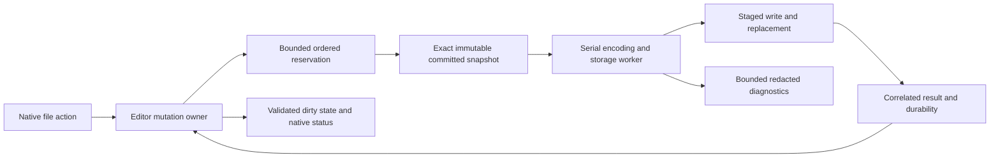

# Task 021: storage, diagnostics and recovery contracts

Starting implementation: `da53ba8`, after the typed Rust session and actual macOS
drawing/save/reopen journey. This is authorized downstream preparation; upstream task
acceptance and the final all-platform refactor remain separate.

## Save ownership

The editor has one mutation owner. A process-wide storage coordinator reserves a bounded
FIFO slot before a snapshot is captured. A save carries opaque session, request,
revision, destination, destination-binding generation and write-sequence identities.
Host adapters own canonical destination identity, access grants, filenames and paths;
private paths and names never enter diagnostic records.

Explicit Save cancels transient input according to native file-action policy. After a
destination is confirmed, the owner captures the exact committed revision into an owned
immutable snapshot and moves it to a serial encoding/storage worker. Checkpoints capture
from an idle callback, never from a pen callback; they omit drafts and predictions.
Snapshot capture initially copies the document synchronously. This is O(document) and
can delay subsequent event delivery; measure it separately and do not label it bounded-time
or background work. Encoding, checksumming, file I/O and flushing run off the editor owner.
Task 020 may introduce structural sharing after ownership/equivalence review. An
incremental copy that silently changes the requested revision is not an acceptable Save.

Reserve queue capacity and estimated snapshot memory before copying. Configuration bounds
the active job, pending jobs and retained snapshot bytes; full admission returns Busy.
Do not silently coalesce explicit saves. Duplicate requests for an already pending exact
revision/destination may be reported as already pending. Checkpoints may replace one
pending checkpoint with the newest requested revision; explicit saves take priority before
checkpoint admission. An active write is never interrupted by dropping its snapshot.

Reservations are FIFO before preparation, not arrival order after encoding. An unready
reservation must become ready, cancelled or failed; it cannot disappear and submit later.
One serial worker orders writes across windows, including aliases to the same destination.
Cancellation before write and a completed write after cancellation are distinct outcomes.
Cancellation never claims to roll back a disk write that already happened.

Only the owner consumes an issued, single-use completion. Unknown, repeated, cancelled,
closed-session and obsolete destination-binding completions cannot mark the document clean.
A successful save of an older revision preserves newer dirty edits. Checkpoint/export-copy
success never marks clean. Save As adopts its destination only after confirmed success;
a superseded binding result cannot restore an older filename. Read-only and export
capabilities are enforced in Rust before admission, not by disabling native buttons alone.

## Native presentation

Use AppKit sheets and controls. Ordinary saves show Saving… while drawing stays available.
Further Save requests obey bounded admission; disable another destination-changing Save As
while one is pending. Native panel cancellation preserves the current binding and history.
Preserve field validation and restore valid prior focus; do not route text-field editing
keys to canvas actions. Command-Shift-S gets an independent real keyboard regression test.

New/Open/Close/Quit waits asynchronously for relevant outstanding explicit writes, with
Finishing save… and Cancel to cancel the navigation intent. Reevaluate dirty state after
completion. The existing Save / Cancel / Don't Save decision remains native. Continue a
pending replacement only once, after its exact save succeeds and no newer edits remain.
Use deferred termination, never a main-thread disk wait. Failed saves preserve edits and
offer Try Again, Save As… and Cancel; retry captures a new current snapshot. Obsolete
failures are recorded without interrupting a replaced document.

## Local durability and recovery

Desktop writes stage in the destination directory, sync the file, then replace atomically
where supported. Failure before replacement preserves the prior destination. A directory
sync failure after replacement is a written result with a durability warning, not a false
claim that the destination was unchanged. Observe cleanup failures. Providers with weaker
guarantees must declare them; this policy is not a universal power-loss guarantee.

Recovery uses a host-generated cryptographically random 128-bit identity with exclusive
allocation, independent of runtime session counters or timestamps. Versioned envelopes
validate lengths, identity, generation and document bytes before becoming candidates.
Checkpoints never overwrite user files or clear dirty state.

Adopt these configurable defaults: request after 2 seconds without committed changes or
at a 30-second scheduling interval; one active checkpoint and one coalesced pending revision;
two valid generations per session, at most 20 retained sessions and 256 MiB total including
staging/metadata, within the existing 64 MiB document ceiling. Reserve space before writes.
These are scheduling/retention defaults, not a maximum-loss or latency promise. Preserve
the previous valid generation after failure. Expire only resolved/superseded recovery data
after seven days; never silently evict an unresolved session's last valid generation.
At capacity retain existing recovery, suspend new checkpoints and expose a management action.

At launch validate candidates, falling back to an older valid generation if needed. Present
Recovered drawing available with Open Recovered Copy, Later and Discard…. Later/Escape
preserves the candidate; Discard requires a separate confirmation defaulting to Cancel.
File → Recover Drawings… lists deferred candidates in native controls. Restoring creates a
new dirty session without a destination, preventing accidental overwrite of the original.
Keep recovery until its content is explicitly saved or discarded. Corrupt recovery must
not replace current content or delete unrelated valid candidates.

## Diagnostics and compatibility

Use structured enum codes, opaque correlation IDs, revisions, counts and monotonic durations.
No free-form errors, paths, names, document bytes, coordinates or per-sample production logs.
Bound ring capacity, repeated events and export/rotation; expose dropped-event/sink-failure
counts. Sink failure must not affect editing or saving. Native sink adapters drain outside
the ink path. No hosted telemetry or global logging settings are introduced.

Keep ABI 2, Wasm protocol 1 and document bytes unchanged. Introduce typed session/snapshot
handles through a separate additive versioned bridge when the macOS host adopts them.
Do not mix unrelated typed-session identity into legacy mutable editor handles or claim
that old synchronous APIs became asynchronous. Native worker/platform dependencies need
an explicit boundary from portable editor semantics.

## Implementation and evidence

021A introduces pure Rust admission, snapshot, capability and acknowledgement contracts;
021B adds bounded native worker/storage, diagnostic and recovery services and failure fixtures.
019 adopts these through a typed bridge and native coordinators/presenters. Lead owns
contract changes; workers use isolated worktrees. New source and tests stay <=200 lines.

Cover SAVE-001/002/003, LOAD-001, INK-002 and ASYNC-001 with invalid/duplicate/stale callbacks,
undo/redo revision identity, queue limits, cancellation before/after replacement, same-path
ordering, read-only denial, prediction exclusion, disk/access/cleanup/log failures, corrupt
and oversized candidates, and disposable process kills at persistence checkpoints.
Add native cases for asynchronous Save, destination ordering, close/quit, Save As keyboard
delivery, field focus, checkpoint/recovery and actual AX state. Actual executable mappings
and host evidence remain distinct; no physical pen/latency or VoiceOver claim is inferred.

