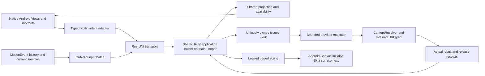

# Android portable application adoption

Next-host plan from the Rust specialist's read-only audit at `8891078`. This is not an
implemented Android migration or native acceptance. Finish the current browser renderer
slice before opening this implementation. Retain Material Views, current controls, shortcuts,
field focus, existing Fit behavior and provider-operation interaction restrictions. No new
color control or other product feature is authorized.

## Shared contract checkpoint

One contract owner first adds `ScaleAnchor::SelectionTopLeft`, with wire scale anchor tag
`2`. Existing tag `1` and center behavior remain unchanged. Android's current numeric Scale
uses top-left; silently recentering it is not a refactoring. Validate selection, factor,
composed transform, bounds and revision capacity before cancelling an interaction. Resolve
the anchor from committed state even when a preview exists. Accepted scale cancels once and
adds one undo entry only for a changed transform. Factor `1` adds no history. Repeating a
relative scale scales again: request correlation is not operation deduplication.

Own only core `application/actions.rs`, `prepared_action.rs`, relevant tests, wire
`decode_commands.rs`, real C/Wasm consumer cases and contract documentation in this checkpoint.
Freeze and independently review it before Kotlin consumes the additive tag.

Other required behavior already fits the portable contract:

- Create through opcode `8` with `AlwaysChoose`, including direct and guarded Save.
- Use opcode `9` for full committed document bounds; retain Android's padding/zoom policy.
- Incoming VIEW/drop starts ordinary editable Open. Keep the already selected URI bound to
  the exact pending native request across the shared unsaved guard. Satisfy its ChooseSource
  effect with opcode `22`, instead of opening another picker. Release the retained source
  on cancellation/staleness. Viewer-only ViewSource is not an editable import shortcut.

## Rust JNI ownership checkpoint

Add `sketch-app-jni` as a `cdylib` over safe `sketch-app-bridge`. Replace authored C++ glue;
retain the independent C ABI and its compiler-consumer tests. The audited candidate is
`jni = "=0.22.4"`, unnecessary features disabled; validate pinned Rust/Android compatibility
before accepting it. Do not implement handwritten JNIEnv tables or use pointer values as
handles. [Official jni-rs API](https://docs.rs/jni/0.22.4/jni/)

Freeze a separately versioned receipt layout before implementation. A 128-byte candidate
can carry status/flags, six u64 fields and the existing structured error; it is not the
Wasm scratch layout. Kotlin carries opaque u64 handles in Long bit patterns, never Double.
Kotlin allocates a direct receipt ByteBuffer before each potentially consuming call. JNI
validates directness, writability, length, capacity and nonoverlap, and resolves its address
before dispatch. The local Java reference keeps storage alive through the native call.
After successful transfer, publish into that prevalidated storage without Java allocation,
callbacks or constructing exceptions. Rejected preflight must never mutate Rust state.

Reply buffers remain separately owned until copied/freed. A later JVM allocation failure
must not lose a result or cause committed work to run again. Preserve rejected-transfer
ownership, catch unwinding at every export and quarantine terminal faults honestly.
JNI environments and local references never cross worker threads. Only uniquely owned
work/results move according to the bridge contract; the creating Main Looper owns the app.

Suggested modules: exports, receipt validation, app owner, issued work, buffers and error
translation. Keep every source/test at most 200 physical lines with a clear responsibility.

## Kotlin and provider checkpoint

Separate transport/packet codecs from Android imports so real JVM tests can load the host
Rust JNI library. Compose `EditorSession`, native presenter/keyboard, issued document effects,
provider-resource registry, bounded provider worker, scene lease and Activity retention.
Remove blanket canvas cancellation from button/shortcut wrappers. Rejected shared actions
preserve gestures; accepted outcomes reconcile local pointer/resize state. Lifecycle loss,
coordinate remapping and ACTION_CANCEL remain explicit cancellation boundaries.

Batch each MotionEvent's ordered historical/current real samples into opcode `12`, preserving
pressure absence and provenance. Do not cross JNI separately for each historical sample.
No prediction is persisted as a real sample.

Provider work follows TakeWork → actual encode/read/write → Complete on owner → Apply →
drain releases. Retire work has its own completion path. Kotlin does not acknowledge document
revisions itself. Existing “Save a copy…” semantics acknowledge a matching saved snapshot,
so use shared Save/AlwaysChoose, not browser-style unconfirmed ExportCopy.

A successfully closed provider stream may use the established provider-confirmed outcome;
it is not a filesystem fsync guarantee. Once truncation/write may have happened, subsequent
failure is Uncertain. Neither failure nor uncertainty can satisfy guarded navigation.
Timeout does not prove a worker stopped or permit a later write to overtake it.

Keep grants and URI objects through actual work termination and any remaining Rust resource
or binding lease, including Activity recreation. Release only when both lifetimes permit it.
Retain the coordinator without retaining the destroyed Activity. Final destruction detaches
the session, completes late work and releases resources on the owner, then frees the app.
Never free an app handle from a JVM finalizer thread. Process-death recovery remains separate.

Scene opcodes `40–44` replace flattened DoubleArray rendering. Stage all descriptor and
geometry pages before publication, reuse pinned root/geometry identities, and retain the old
coherent frame on failure. Respect 1,365-descriptor and 744-path-record pages. Fill complete
contours once with nonzero winding. Subtract f64 origin before Android Float conversion,
bound disposable Path caches, and release each changed lease once. Android Canvas remains
explicitly interim; this checkpoint does not complete Android Skia adoption.

## Verification and removal checkpoint

Before deleting production C++ or shipping replacement libraries, run a real JVM against
the host Rust JNI dylib. Test high-bit identities, wrong app/kind/thread, duplicate release,
receipt preflight failure before mutation, actual worker transfer, rejected completion,
encode failure that already consumed work, and controlled shutdown with outstanding work.

Test atomic input batches, rejected-action preservation, accepted cancellation, top-left
scale/identity/one-operation undo, direct/guarded chooser policy, stale writes and delayed
reads, provider uncertainty, incoming-source cancellation, paging/root reuse and cache
admission failure. Map executable cases to FFI, INPUT, INK, UNDO, SAVE, LOAD, ASYNC, RENDER
and CACHE invariants. Compilation and injected provider tests are not native Android E2E.

Build ARM64 and x86-64 `libsketch_app_jni.so`; inspect APK contents so stale ignored jniLibs
cannot ship legacy `libsketch_ffi.so` or C++ `libsketch_jni.so`. Only then retire bridge.cpp
and its build integration. Run Rust format/Clippy/tests, strict TypeScript/Oxc, androidQuality,
real JVM/JNI tests and both ABI builds. Preserve source/toolchain/library/APK hashes and
failed attempts. MotionEvent delivery, SAF UI, native field shortcuts, recreation, TalkBack
and ChromeOS hardware acceptance require their actual environments and remain pending.

The audited host has project Gradle 9.3.1 and NDK 30.0.16248370 plus installed Android SDK
37.0/build-tools 36.0.0 and Studio JDK. The script's historical `/private/tmp` NDK default is
gone. Resolve existing project-scoped toolchain paths, including prior Skia probe evidence,
before installing anything. Do not change global defaults or open Android Studio/emulators.

The prior Skia probe confirms ARM64 compilation with project
`RUSTUP_HOME=.build-cache/toolchains/rustup`, Rust `1.99.0 (b940084d7 2026-09-28)` and the
NDK above, using its `aarch64-linux-android26-clang` linker. The default user toolchain's
target inventory is not proof that the required project-scoped target is absent.

Ownership: the lead/contract owner freezes shared Rust changes and quality mappings; one
isolated implementation worker owns the JNI crate, Kotlin/tests and Android build adapter.
Agree workspace manifest/lock ownership before starting. A fresh reviewer checks transfers,
provider failures and evidence; the designer reviews preserved native behavior when desktop
access is permitted. No merge, release or all-platform acceptance is implied by this plan.

## Designer-reviewed interaction acceptance

Read-only designer audit at `9124ec5`; these cases are planned, not native runtime evidence.
The lead accepted the known-unavailable-action policy: consume the canvas shortcut without
modal, mutation or cancellation. A modal for ordinary rejection would lose window focus
and indirectly cancel the draft. Native text editing has priority; local validation remains
local. Genuine fatal/provider errors retain explicit presentation. Current Kotlin blanket
button/shortcut cancellation does not yet satisfy this policy.

| Planned ID | Preserved behavior to verify |
| --- | --- |
| ANDROID-FOCUS-001 | Width/Scale text editing retains caret, selection and all ordinary editing shortcuts; invalid width stays in its dialog with inline error |
| ANDROID-ACTION-001 | Unavailable canvas shortcuts preserve interaction; accepted controls and shortcuts route equivalent shared commands and reconcile local capture |
| ANDROID-SCALE-001 | Committed top-left anchor, including during preview; repeated relative scale repeats; identity scale adds no undo; drag handle retains its existing anchor |
| ANDROID-FIT-001 | Full committed bounds, 48dp total padding, centered result, maximum zoom 8, empty reset, large fits below .001 and no inward movement from Zoom out |
| ANDROID-FILE-001 | Direct/guarded Save always opens SAF; only matching confirmed completion clears dirty or continues; failure/cancel/uncertainty retain content |
| ANDROID-INCOMING-001 | VIEW/single-file drop follows editable Open; exact retained request crosses the guard; Discard does not open a second picker |
| ANDROID-ASYNC-001 | Actual provider lifetime controls editing restrictions; stale results cannot replace state, resurrect dialogs or steal field focus |
| ANDROID-RECREATE-001 | One owner, document/history/settings/viewport and exact pending identities survive recreation without duplicate effects or destroyed Activity retention |
| ANDROID-INPUT-001 | Atomic ordered history/current batch; pressure/provenance retained; second touch, cancellation, focus loss and resize cancel before remapping |
| ANDROID-PRESENTATION-001 | Existing Material controls/four color presets, 48dp targets, 840dp side-panel transition, short-window scrolling, DayNight appearance and accessibility description |

Pending effects must be re-presented from the retained coordinator, not reconstructed as a
new navigation intent. This does not promise process-death recovery or restoration of an
unfinished dialog's text. Existing replay verifies only part of the field shortcut matrix;
JNI/JVM tests and compilation cannot substitute for SAF, TalkBack or native delivery checks.
