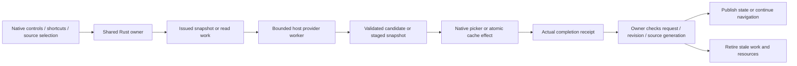

# Apple portable adapter adoption

Read-only designer audit at `05ca6f5`. The existing UIKit and viewer modules have been
decomposed but retain legacy ABI/rendering. This plan preserves their implemented behavior;
it is not completed migration or native acceptance. Freeze the shared contracts below with
the Rust owner before replacing host logic. Do not treat compilation as device/UI evidence.

## Shared contracts that still need definition

**Staged nonbinding save.** UIKit captures a document revision, writes a temporary file,
presents the native export picker, and acknowledges that captured revision after picker
success. It keeps no reusable destination. Successful guarded Save may resume New/Open.
Portable SaveAs currently chooses a destination before writing and retains its binding;
ExportCopy neither acknowledges a saved revision nor satisfies guarded navigation.
`AlwaysChoose` is therefore insufficient. Define issued snapshot/encoding and temporary
staging work, exact picker continuation, truthful completion, matching-revision acknowledgment,
guard continuation and temporary-resource retirement as one shared protocol.

**Copy import.** UIKit imports with `asCopy: true` and releases security-scoped access after
reading. Portable replacement currently retains a source binding. Define explicit copy-import
policy and lease retirement, retaining no overwrite destination. Do not silently extend
provider access merely because a binding exists in another host's implementation.

**Validate, cache, then publish.** TV/Watch validate candidate content, atomically cache it,
and only then replace the displayed drawing. Portable PrepareRead returns an opaque result,
without a candidate/cache-publication protocol. Define bounded validated-candidate ownership,
observable validation outcome, issued cache work and final generation admission. Cache
failure retains the old document. Cancellation during cache work must prevent stale data
becoming the next restored selection, not merely prevent the current screen update.

**Source policy.** Watch already uses shared Rust source comparison through the legacy
`sketch_source_compare`. Add an equivalent portable boundary for namespace/document identity,
revision lineage, content hash, server generation and phone-only restrictions. Source
protocol version 2 is independent of application wire version 2. Preserve both contracts.

**Owner lifetime.** A view/scene can detach while uniquely issued work is still alive.
Retain the mutation owner/coordinator independently until actual results, resource releases
and shutdown obligations settle. No UI callback may manufacture completion or free a live
owner merely because its controller disappeared. Keep bounded correlated diagnostics.

This diagram defines responsibilities, not final opcode names or frozen layouts. Reuse the
existing commands, resource leases and actual completion machinery; add narrowly typed
policy/continuation variants rather than overloading unrelated viewer/export operations.

## Preserved per-host acceptance

| Host/seam | Observable behavior |
| --- | --- |
| iPhone/iPad files | Existing native pickers/controls. Cancelled, failed or stale export keeps dirty state and stops guarded navigation. Corrupt/oversized import retains content. Successful copy import resets viewport and Watch publication identity. |
| UIKit input | Coalesced actual samples remain ordered; pressure is supplied only for Pencil. Second contact cancels ink before navigation. End commits once; interruption/rotation/deactivation cancel before remapping. Native text editing and modal commands have priority. |
| Vision | Preserve Pen/Select/Pan and Select default, indirect recognition without inventing touch/pressure, native controls and current 2D canvas scope. |
| Apple TV | Rust-enforced read-only session. Bounded HTTPS/sample loading; superseded, corrupt, cancelled or cache-failed requests retain displayed content. Fit/navigation never mutate the document. Cache eviction remains an offline limitation. |
| Apple Watch | Cached library opens offline. Phone is the default source; timeout/unavailability permits configured network fallback only for eligible identical drawing identity. Late replies never become unsolicited pushes; pushes cannot hijack another selection. Updates during navigation stay staged until Apply Update. |
| iPhone → Watch | Publish an immutable captured copy with captured identity. Sharing/transport never marks the editor saved. Retain outgoing files until WatchConnectivity completes; move incoming temporary files before its callback returns. Retain limits and legacy-cache migration. |

Controls and shortcuts use shared typed action availability. Validate before cancellation;
test rejected actions with active drafts rather than reproducing blanket host cancellation.
Existing color controls remain; this migration does not authorize new controls or tools.

## Verification sequence

1. Freeze policy/continuation/candidate/source contracts and their error, thread and lifetime
   rules. Add meaningful core tests before exposing portable packets. Preserve old layouts.
2. Add real native C and Wasm consumers for additive operations, exact bytes, stale/foreign
   ownership, insufficient output capacity, candidate budget, cancellation and shutdown.
3. Migrate one Apple host seam at a time: Swift owner/transport, native file effects,
   input/presentation, then read-only source coordination. Keep resource release correlated
   to actual work, not a callback's optimistic status.
4. Verify real Swift bridge/worker tests and simulator/device compilation in the background.
   Skia availability/linkage and each renderer adapter remain separately evidenced.
5. Reserve native host sessions for document pickers, Pencil/indirect input, focus,
   accessibility, suspension and paired Watch delivery. These remain pending during the
   owner's no-app-control window. Hardware/OS absence is a coverage gap, never a pass.

Map `SAVE-001/002/003`, `LOAD-001`, `ASYNC-001`, `SOURCE-001`, `VIEW-001`, `INK-001/002`
and `FFI-001` to concrete executable cases as each seam is implemented. Retain failed runs,
exact source/build identities and a fresh independent review. Task 024 remains open.

Reference implementations: `apps/ios/Sources/DrawingDocuments.swift`,
`apps/apple-viewer/SourceCoordinator.swift`, `apps/apple-viewer/WatchLibraryStore.swift`,
and [portable wire](022-portable-wire.md). The audit did not build or launch these apps.
