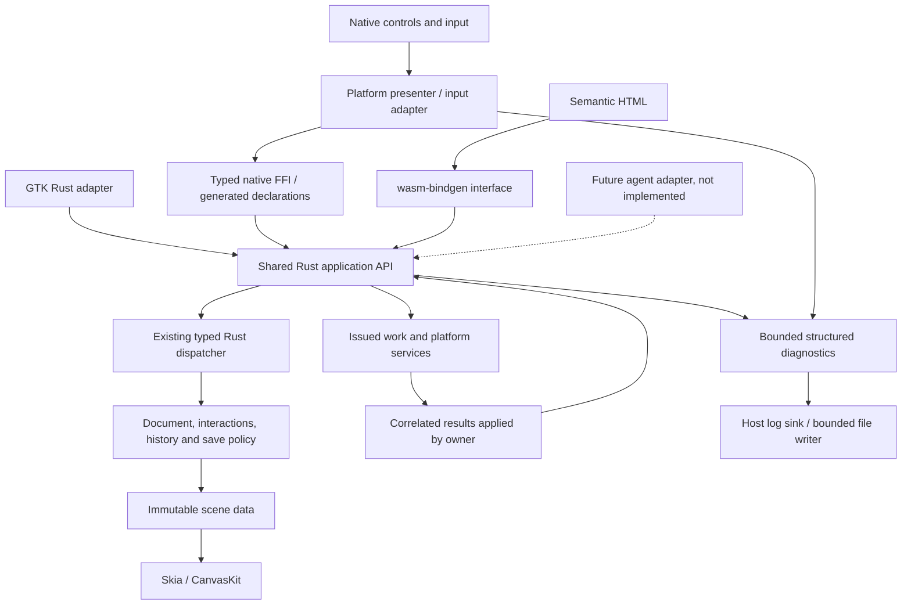

# Task 022: typed bindings migration

Decision recorded 2026-10-16 from the owner's explicit request to replace the custom
binary protocol with typed FFI and generated declarations. This is the approved target
direction and implementation plan, not a claim that consumers have migrated. The current
request changes planning/instructions only. Freeze the concrete API before implementation.

This supersedes packet/opcode/layout prescriptions in the earlier 022 portable documents.
Their command, provider, revision, cancellation and lifetime requirements remain in force.
Document serialization is separate: preserve existing saved document bytes and upgrades.

## Architecture and boundaries

- Keep `sketch-core` as the authority for commands, validation, history and persistence
  semantics. Keep useful `sketch-app` coordination; do not create a second state machine.
- Evolve the working native-v1 interface where practical. Define one semantic application
  API shared by native adapters, Linux direct calls and Wasm; adapters only translate types.
- Generate native C declarations from explicit Rust ABI types using cbindgen. A C ABI is
  a language boundary, not a new C implementation. Pin the generator during implementation.
- Swift imports generated declarations; C# uses typed interop; Kotlin uses a narrow Rust
  JNI adapter; Linux calls Rust directly; browser uses wasm-bindgen-generated JS/TS bindings.
  cbindgen does not generate complete language wrappers. Verify each actual consumer.
- Do not adopt UniFFI or a second general binding framework incidentally. A change to this
  choice needs the architecture review gate in AGENTS.md, including ownership constraints.
- Keep output crates where target/linking requirements justify them. Remove packet-only
  codecs/registries when unused; retain resource safety. Do not optimize for crate count.

## Typed interface requirements

- Expose named operations for session lifecycle, commands, sample batches, projections,
  scene access, issued work and completion. Preserve Rust command enums internally.
- Specify fixed-width ABI fields, explicit tagged records, bounded pointer/count pairs,
  nullable rules, alignment, UTF-8 lengths and error codes. Never expose Rust's internal
  enum/Vec/String layout or assume platform-sized integers have identical widths.
- Validate foreign tags, lengths, finite coordinates, capabilities and whole batches
  before mutation. Types at the boundary do not make untrusted values semantically valid.
- Use opaque validated handles where necessary, explicit retain/release or close rules,
  and immutable bounded leases for large scenes. Define behavior for stale handles,
  repeated release, wrong-owner calls and reentrancy. Arbitrary invalid pointers are outside
  a borrowed-buffer contract; do not claim all pointer misuse can safely be detected.
- Borrowed input is valid only for the synchronous call. Work retained after return must
  own/copy its input or hold an explicit lease. Do not promise zero-copy across every host.
- Never unwind through FFI. Define panic quarantine, error ownership and teardown rules.
- Before consuming issued work/results, ensure the caller can receive the outcome without
  a fallible allocation losing ownership. Preserve Android receipt-publication guarantees
  in a typed form, rather than carrying forward its fixed binary receipt layout.
- Preserve real write receipts, revision checks, destination ordering, stale-load rejection,
  copy-document policy, viewer capabilities and source identity. None is transport logic.
- Download/export dispatch alone is not confirmed persistence. Host callbacks cannot
  fabricate Rust-issued completion tokens. Cancellation is not proof that I/O terminated.

## Thread ownership

1. Initially native UI and bounded Rust editing transactions share the UI thread. Current
   PortableApp is non-Send/non-Sync; retain its fixed owning-thread contract unless a
   separately reviewed change replaces it. A serial queue or actor can change OS threads.
2. Native callbacks enqueue results to that owner; no worker mutates the live editor.
   Foreign language wrappers enforce/check affinity and guard against reentrant commands.
3. Background work owns immutable input and has bounded admission, explicit cancellation,
   and session/request/revision correlation. Apply results only after validating identity.
4. Each Skia context has an explicit owner. No new render thread, editor thread, executor
   or browser Worker is introduced merely to change bindings. Such changes require review
   and measurements. UI-only operations remain on the platform UI thread.
5. Preserve ordered real samples and command boundaries. Supersede predictions/complete
   render snapshots only where equivalent. Never silently drop edits or ordered deltas.
6. Explicitly close thread-affine resources on their owner. Finalizers on arbitrary threads
   cannot directly destroy them. Test shutdown with outstanding jobs and late callbacks.
7. No filesystem, logging flush, blocking worker wait or GPU wait in the input path.
   Do not hold locks while invoking native callbacks or waiting for another executor.

Platform ownership follows [runtime](runtime.md): Apple main thread, Android Main Looper,
WinUI UI dispatcher and GTK main context; DOM main initially on web. Native FFI calls do
not create a worker. Ordinary async syntax does not move CPU work off the calling executor.

## Structured logging contract

Instrument semantic boundaries once, not every button or model setter. Proposed event
families: action.received, command.completed, state.changed, work.started/completed,
frame.submitted/presented and failure. Presented requires actual supported timing evidence.

- Common envelope: schema version, build identity, event code/level, monotonic timestamp,
  owner-local sequence, session/request/operation IDs where applicable, and outcome.
  Correlate work/frame/surface/revision IDs without pretending concurrent events are ordered
  by timestamps alone. Correlation is not automatic command deduplication.
- Native adapters record origin (shortcut/control/pen/touch; future agent when implemented).
  Rust records acceptance, rejection/no-op and selected before/after state metadata.
  Preserve origin and request across workers; render frames may incorporate multiple requests.
- Log committed mutation after success; rejected commands cannot claim state changes.
  Native text-field shortcuts are native events, not Rust document commands.
- Normal mode: failures, recovery and selected lifecycle events. Debug mode: semantic
  actions/state transitions. Explicit trace mode: bounded timing capture. Never log each
  pen sample in production or format whole state/documents for diagnostics.
- Allowlist safe fields; exclude paths, document/user text, sample coordinates, credentials
  and raw foreign error strings. Error codes and opaque correlation IDs are sufficient.
- Bounded memory queues, rate limiting and rotating local sinks; count drops and sink
  failures. Drain/format/write off input callbacks. Logging failure cannot fail an edit.
  Logging is diagnostic and may lose buffered events on crashes; it is not a recovery log.
- Platform sinks may format the same event for native logs or browser console. No hosted
  telemetry, new export UI or Workbench viewer is authorized by this plan.
- Keep current diagnostics working during migration. Consolidate schemas deliberately;
  do not duplicate a failure at every layer or claim these proposed events already exist.

## Implementation slices and gates

Execute sequentially under task 022; freeze exact starting revision and one contract owner.
Update task evidence/feature-test mappings per slice. Status for all slices below: planned.

| Slice | Deliverable | Required exit evidence |
| --- | --- | --- |
| 022A | Inventory actual consumers and legacy paths; concrete API/type/lifetime map, owner-reviewed contract | Named symbols, capabilities, dependency map, migration/removal and rollback plan |
| 022B | Typed vertical slice: Undo, stroke batch, scene lease, async save success/failure/cancel | Real Swift consumer, generated declarations reproduce, Rust differential/ownership tests |
| 022C | Common diagnostic envelope and dispatch/service hooks | Redaction, correlation, rejection, overflow, sink-failure tests; measured overhead |
| 022D | macOS adoption and removal of duplicate adapter behavior | Existing UI/Skia behavior, save/recovery/focus regressions; authorized native session |
| 022E | Web, Android, remaining Apple, Windows and Linux adoption one host at a time | Actual language consumers, provider/command parity; native E2E on applicable hosts |
| 022F | Retire unused protocol implementations and update tooling/docs | No production consumers, package/symbol/dependency scan, fresh review; 024 packet updated |

For 022A, present exact signatures, ownership, examples, alternatives, risks and migration
cost to the owner before freezing implementation. Direction is approved; that review is
not permission to reopen Skia selection or add features. Continue independent authorized
documentation/test preparation while waiting, without implementing an unapproved contract.

## Migration tests and performance evidence

Planned acceptance IDs (register with discovered tests during implementation; not passes):

| ID | Required proof |
| --- | --- |
| BIND-001 | Same initial fixture + command/sample sequence through old/new paths yields equivalent document, history, projections, effects and error outcomes; ignore incidental transport IDs only |
| BIND-002 | Actual generated declarations compile/link with Swift and C#; real JNI/Kotlin and browser JS/Wasm consumers exercise the API; Linux Rust conformance |
| BIND-003 | Invalid tags/batches, stale handles, wrong-thread/reentrant calls, teardown and lease ownership fail without partial mutation or leaks; supported sanitizers/fuzz tests |
| BIND-004 | Stroke cancel/prediction isolation, one-operation undo, readonly rejection, save ordering/revision, uncertain writes and late imports remain unchanged |
| BIND-005 | Native shortcut/control and text-field focus journeys, save/provider cancellation and renderer surface lifecycle on applicable hosts |
| LOG-001 | Correlation and origin survive worker handoff; applied/rejected/no-op events agree with actual state |
| LOG-002 | Sensitive fixtures never enter logs; queue overflow, disabled levels, sink failure and rotation preserve application behavior |
| BIND-006 | Release binding time, allocations/copies, queue delay, dispatch and frame stages measured separately with logging off/normal/trace |

Use identical workloads, canvas/cache settings, builds and named hardware; include warm-up,
repetitions, p50/p95/p99 and variability. No percentage improvement is presumed. Native GPU
checks need reserved desktop access; software measurements do not establish physical pen
latency. Preserve rendering quality and sample completeness when comparing throughput.

Keep old/new implementations side by side only during a bounded migration, with one
authoritative editor per production session. Differential tests use separate disposable
sessions. Do not dual-submit real saves. Restore the previous adapter on a regression;
do not fork application semantics. Remove old paths only after every consumer is accounted
for; unsupported host evidence stays pending and cannot qualify retirement on that host.

Task 024 requires this migration's evidence, protocol retirement inventory, logging tests,
designer review for native behavior, and a fresh independent review. Neither this document
nor a green portable test suite completes all-platform acceptance.
