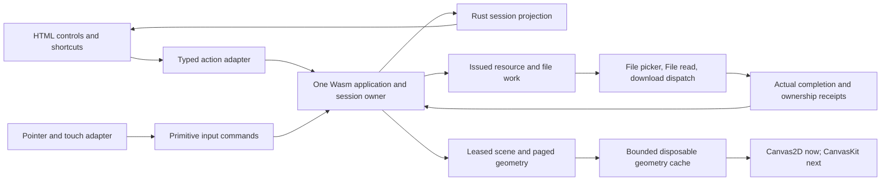

# Browser portable-command adoption

Lead handoff, reviewed against `6b46fb4` by rust_engine and ui_ux_designer on
2026-10-16. This is the next bounded task 022 implementation slice after the workbench's
process-ownership repair. It does not change the selected Skia/CanvasKit direction.

## Preserve behavior before replacing the renderer

The current browser uses legacy Wasm v1 commands, host-owned compound actions/file guards
and flattened scene copies. Migrate it to the existing portable v2 facade with one editor
owner and issued file work. Retain current semantic HTML controls, zoom range, touch
navigation and Canvas2D presentation during this slice. CanvasKit integration follows
against the reviewed scene boundary; no new Fit control or color feature is authorized.

No new Rust policy appears necessary. If implementation discovers a missing semantic,
stop that portion and ask the lead/contract owner to extend the shared boundary; do not
reintroduce the rule in TypeScript.

## Commands and local input ownership

Create the session through policy opcode 8 with `AlwaysChoose`; initialize existing brush
defaults through Rust settings commands. Tool, selection, history, dirty state and action
availability come from Rust projections. Never read widget values inside BeginStroke.

ChooseTool, CycleSelection, Undo, Redo, DeleteSelection and ScaleSelection use the same
typed action for toolbar and shortcut routes. Input retains primitive Begin/Append/Commit/
Cancel and transform commands. Validate optional pressure and preserve full BigInt IDs.
Never retain a typed-array view across a Wasm call that can grow memory.

Remove generic cancellation from click, keyboard and recoverable-error wrappers, including
`presentation.safe`. Rust validates before cancelling an interaction. Unavailable Undo and
invalid scale preserve a draft/preview; accepted compound actions reconcile local pointer
capture against the resulting Rust interaction. Blur, capture loss, Escape and viewport
coordinate remapping remain explicit cancellations. Native text-field editing has priority;
unfinished numeric input remains text until a valid commit.

## File effects and browser authority

| Existing intent | Portable mapping and result |
| --- | --- |
| Download copy / keyboard Save | ExportCopy, unconfirmed download capability |
| Browser accepts download dispatch | DispatchedUnconfirmed, never Written |
| Guard Cancel / Escape | Cancel the exact issued continuation |
| Guard Discard | Shared UnsavedChoice::Discard, then returned navigation effect |
| Guard Download copy | Cancel navigation first, ExportCopy current content, stay in document |
| New / Open | Shared navigation intent and returned effects |
| Selected upload | Read-only resource and issued read/prepare/apply lifecycle |

**ExportCopy preserves the existing dirty state.** It cannot acknowledge or clear unsaved
edits; it also must not mark an already clean reopened document dirty. Guard Download must
not be encoded as UnsavedChoice::Save, which requires confirmed persistence.

Keep the picker in the trusted button/key/dialog event turn. Do not await a worker or
network operation before requesting a picker if that loses browser user activation.
Tests must observe an actual file-chooser request; `setInputFiles` alone bypasses this.
Picker cancellation retires its pending effect, resets the input for selecting the same
file again, and restores appropriate focus. Dialog Escape must not reuse a prior choice.

An obsolete read cannot replace later edits, a draft, New or a newer import. Retire the
candidate on stale completion; if opening that immutable File is still intended, begin
a fresh shared navigation/confirmation flow. Never manufacture a new ticket or cancel
newer input merely to force installation. Obsolete error messages must not steal focus.

Keep resource handles through actual work completion. Bound retained File objects, bytes,
object URLs and issued operations. Release exactly once on success, failure and cancellation.
Drain outstanding work/results/releases during controlled shutdown; page termination alone
is not a successful shutdown acknowledgment.

## Scene and scheduling boundary

Use scene opcodes 40–44: one current lease, paged descriptors/geometry and bounded copied
geometry/Path2D caches. IDs are opaque facade identities, never pointer addresses. Schedule
scene acquisition during repaint, not per pointer sample. An unchanged scene must not
retransmit all geometry. Changed leases release exactly once; same-reference reuse adds
no implicit retain.

Assemble a complete, identity-consistent geometry before one nonzero fill. Preserve f64
coordinates, origin/transform order and draw ordering; suppress the original selected
stroke during transform preview. Failed/stale reads retain the previous coherent scene,
never a mixed partial frame. Replacement/history invalidate relevant cache identities.
Opcode 9 can be exposed/tested as an explicit bounds query, not called on every repaint.

The first slice retains browser-main mutation ownership. File encoding/decoding runs only
from explicit issued work outside pointer callbacks with bounded admission. An asynchronous
File read does not make synchronous Wasm work run on a background thread. Document this
limitation; do not claim latency completion.

A dedicated engine Worker is a separate follow-up: it must own the entire Wasm instance,
with ordered input credits, bounded queues, stale gesture generations and terminal handling.
Numeric handles cannot migrate to a second instance. Picker/download activation and CanvasKit
placement need explicit evidence before moving those operations across an asynchronous hop.

## Ownership and verification

One web writer owns `apps/web/src`, tests/E2E and the v2 production asset integration in
`scripts/platforms/web.ts` and `apps/web/asset-manifest.ts`. Keep legacy v1 conformance in
separate output paths so compatibility tests cannot overwrite the production v2 asset.
Use existing strict TypeScript/Oxc and 200-line gates. The Rust contract owner reviews any
requested wire change before consumers proceed. Fresh review and designer review follow.

Required checks supplement, rather than replace, every existing browser journey:

- Actual Wasm: high-bit handles, memory growth, output exhaustion, rejected transfer,
  quarantine after trap, and complete controlled-shutdown retirement.
- Actions: unavailable Undo/invalid scale retain interaction; accepted Undo cancels draft
  and removes one committed operation; toolbar/shortcut command streams are equivalent.
- Files: dirty and clean download behavior; guard Download stays; repeated picker cancellation;
  corrupt/oversized input; delayed/out-of-order reads; intervening edits/New/import; release counts.
- Scenes: unchanged-frame reuse, paging beyond page caps, preview suppression, eviction,
  exact lease retirement and coherent geometry after reopen/undo/redo/delete.
- Browser: real picker activation from Open/button/shortcut/discard confirmation; native
  field focus; no stale-dialog focus theft; offline reload and failed update beneath Pages subpath.

Retain exact source/Wasm/browser identity and failed attempts. Headless Chromium is actual
browser UI evidence, not Safari, native mobile, physical pen or latency acceptance.
