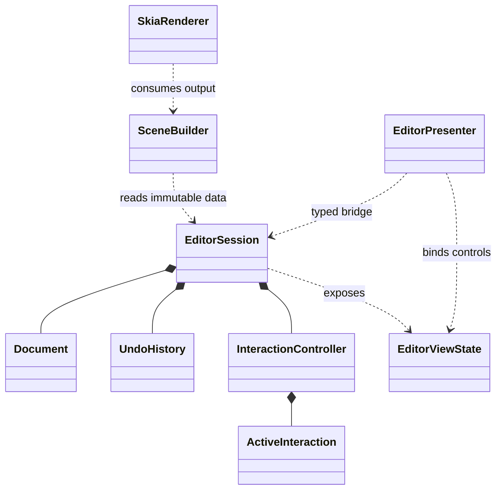
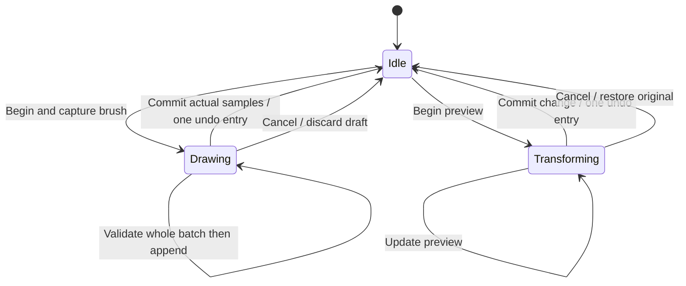

# Components and contracts

Target design; task 015 freezes signatures and compatibility fixtures before implementation.
Prefer modules in existing crates; add crates only for dependency/build boundaries.

## Patterns in existing features

| Pattern | Responsibility | Example |
| --- | --- | --- |
| Composition | Explicit dependencies/ownership | Window owns bridge, presenter, canvas, coordinator |
| Presenter | Bind shared state and route native actions | Undo availability drives menu; width submits SetBrushWidth |
| Adapter | Translate platform data/services | NSEvent/MotionEvent to SampleBatch; clipboard effect to OS |
| State machine | Legal transitions and one transaction | Idle, Drawing, Transforming |
| Typed command | Named validated operation | DeleteSelection, SetBrushWidth, CommitTransform |

No service locator, global event bus, BaseEverything hierarchy, boxed command per sample,
or oversized manager split across extensions. Canvas never reads inspector fields.

## Module map

| Area | Types/modules | Exclusions |
| --- | --- | --- |
| model | Document, Stroke, Brush, IDs, transforms | UI, Skia, OS I/O |
| interaction | InteractionController, InkSession, TransformSession, ActiveInteraction | Widgets, storage, GPU waits |
| application | EditorSession, EditorCommand, EditorViewState, CommandResult | OS-specific services |
| history | UndoHistory, DocumentChange | Predictions, controls |
| geometry | Pressure, outlines, bounds, hit testing | Native events |
| scene | SceneBuilder, RenderUpdate, overlays | Document mutation |
| persistence | Codec, validated candidate, snapshot | Dialogs, access grants |
| source_policy | Identity/version comparison | Network/WatchConnectivity transport |
| ffi / wasm | Layouts, dispatch, ownership, status | Independent editing semantics |

Tests split by behavior, not numbered fragments. Native coordinate/pixel conversion stays
in adapters; common viewport/transform math moves to Rust with explicit behavior tests.

## Semantic controls and actions

Conceptual types, not an approved ABI declaration:

```text
ToolId, ActionId, BrushSettings, ToolState
Availability = Enabled | Disabled(reason)
EditorViewState { session, revision, tool, selection, history, dirty, capabilities }
EditorCommand = SetTool | SetBrush | Select | Delete | Undo | Redo | ...
CommandResult { state_changes, render_invalidation, effects, error }
SaveToken { document_session, snapshot_revision, request_id }
```

Share IDs, units/ranges/defaults, availability and semantic localization keys. Actual strings,
icons, shortcut bindings, widgets and layout stay native. Incomplete text stays local until
valid submission; Rust also validates. Capture brush settings when a stroke begins.
Session commands do not automatically enter history. Editing commands commit changes.
Service requests return effects: copy produces portable content; save produces a snapshot.
Do not execute I/O effects inside mutation transactions or call reentrantly into the editor.
Future agents use typed commands/queries and explicit transactions, not fake pointer input.
Agent transport/auth/permissions are deferred.



## Input and transactions

Normalize device/pointer ID, time/clock domain, phase, buttons, coordinates, optional pressure/
orientation, sample IDs and actual/correction/prediction kind. Missing capabilities remain
missing. Batch across FFI; validate the entire batch before mutation. Preserve correction
timestamp identity. Native focus routing precedes canvas command dispatch.



Invalid transitions return errors without partial mutation. Preserve undo rejection during
active interaction, no-op/no-history, topmost selection and new-document history reset.
Cancel temporary work before native file actions where required by the interaction spec.
Escape, deactivation/capture loss and coordinate remapping cancel explicitly. A second
mobile navigation touch cancels draft ink before navigation. Change policies separately.

## Native object map and lifetime

macOS: EditorWindowController, RustEditorBridge, EditorPresenter, BrushInspectorController,
EditorMenuController, CanvasView, AppKitInputAdapter, FrameScheduler, SkiaRenderer,
MetalSurface, DocumentCoordinator, AccessibilityAdapter. Other platforms use idiomatic
equivalents, not identical inheritance. New/extracted files stay at most 200 physical lines.

The C header remains authoritative: opaque uniquely owned handle, serial use, input borrowed
for one call, explicit output ownership/release. Preserve ABI 2 and Wasm protocol/token
semantics initially. Panics cannot unwind across FFI; caught panic invalidates the handle.
Native wrappers destroy exactly once. Do not add new floating-point encodings of domain IDs;
replacing legacy protocols requires versioning and real-consumer conformance tests.
Save acknowledgements include session and revision so new/import invalidate previous saves.

Retain Android C++ JNI during extraction; Rust JNI replacement is optional later with
equivalent exception/ownership/buffer evidence. Skia remains third-party C++. Do not add
generated and handwritten bindings for the same operation without a migration reason.
