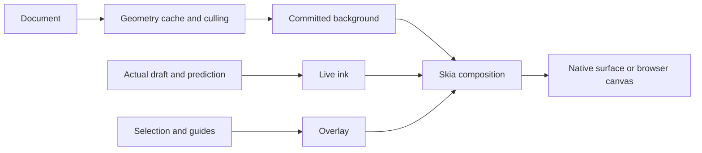

# Skia, scene construction and caching

Skia is selected; integration remains task 020 and platform acceptance tasks. Scene data
stays independent of Skia, but implement only the chosen production backend. Preserve
historical Vello/Core Graphics experiments and their qualified results.

## Layers

Rust produces geometry/paint/transforms and committed/transient overlays. Updates identify
document session/generation and relevant viewport/surface. Hosts own display scale/surface.

| Cache | Content | Invalidation |
| --- | --- | --- |
| Geometry | Committed outlines/paths | Stroke version or brush interpretation |
| Spatial index | Bounds for culling/hit tests | Add/remove/transform |
| Skia resources | Paths/images/GPU allocations | Content/context generation |
| Committed scene | Background beneath live ink | Relevant scene/viewport change |
| Tiles, later if measured need | Bounded rendered regions | Intersecting content, scale/style/color |
| Viewer preview | Validated local preview | Source version/policy/eviction |

Start with geometry reuse, culling, committed background and independent live ink/selection.
Predictions remain temporary. Keep committed stroke preview until the background containing
it is ready; swap without flashing or double ink.

Cache keys include object/tile version, scale/density, color/style and context generation.
A global revision helps consistency but must not invalidate every cache after each edit.
Invalidate old AND new transformed bounds, expanded for width/antialiasing/effects. Respect
draw order, blending and tile gutters. Eviction/context loss must preserve document state.

Use double document coordinates and viewport-relative rendering for large-coordinate
precision. Temporary pan/zoom imagery must not resurrect deleted content. No unbounded
infinite texture: budget resources, evict unused entries, tag/cancel obsolete build jobs.

## Reference rendering

Keep an uncached path for tests. Compare thin/thick/pressure strokes, transparency,
overlap, extreme zoom, large coordinates, clips, tile edges and display scales. Use exact
comparison when deterministic; otherwise justify tolerances and preserve diff images.
Golden/threshold changes require review. Images do not prove edit/persistence equivalence.

## Web packaging

HTML/TypeScript + Rust editor Wasm + CanvasKit JS/Wasm. Start with standard CanvasKit;
custom reduced builds require measured benefit. Historical conversation package measurement
(not rerun or a build of this selected base), CanvasKit 0.41.1:
standard JS+Wasm 7.28 MB raw / 2.93 MB gzip level 9; full 8.20 / 3.28 MB, decimal units.
These are renderer-only, not our app, RAM or actual hosting transfer. Pin/version assets;
measure compressed production payload, initialization, first usable canvas and offline
launch. JS tree shaking cannot remove features from precompiled Wasm. Cache compatible
app/engine versions together; test interrupted downloads and service-worker upgrades.
Reproduce from the [pinned npm package](https://www.npmjs.com/package/canvaskit-wasm/v/0.41.1):
sum standard `bin/canvaskit.js` and `bin/canvaskit.wasm`, compress files individually with
gzip level 9 and sum again. Full variant uses `bin/full/`. Record exact hashes/tool versions.

## Performance

Track sample age, queue delay, editor/scene work, CPU submission, GPU duration, available
presentation timing, first-stroke/after-idle tails, allocations, memory, idle energy and
save/open interruption. Map monotonic clock domains explicitly. GPU completion, draw start
and FPS are not physical pen-to-screen latency.
Reuse Cintiq software fixtures under the recorded visibility/input/caching/viewport protocol.
Serialize GPU work and capture power/display/thermal context. Preserve genuine performance
failures; do not relabel them environmental invalidations. Camera measurements remain pending.
Establish per-device budgets and noise before gates; no universal latency promise here.
