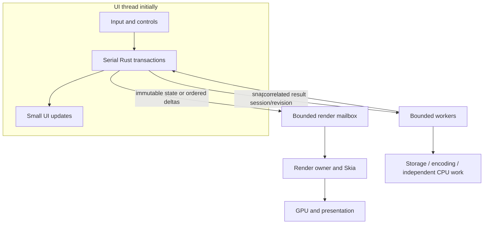

# Runtime ownership and parallel work

Target policy; threading changes are measured separately from structural extraction.
Async does not imply CPU work leaves the UI thread.
The [typed migration](022-typed-bindings-migration.md) preserves these rules independently
of language binding. Current PortableApp/bridge use a fixed OS-thread owner, not merely
serial access. Generated wrappers must not silently introduce locks, worker hops or
arbitrary-thread destruction. Changes to that ownership require explicit owner review.

## Single owner first

Initially the UI thread owns each mutable Rust editor and performs bounded transactions.
No document-wide traversal/copy, encoding, disk, GPU wait or log flush in pen callbacks.
Bounded workers perform snapshot encoding, storage, candidate import and independent CPU
work. Introduce a render owner only with a supported surface contract and measured benefit.
Each Skia GPU context has one execution owner. A serial executor can move between threads;
it is not necessarily suitable for a thread-affine graphics context.

If needed, move the entire editor owner to one dedicated executor. Native input posts
ordered batches and UI receives projections. Do not concurrently mutate one handle.

## Queues, snapshots and cancellation

- Preserve actual samples/order. Replace predictions/redundant repaint requests, not edits.
- Complete snapshots can supersede older snapshots. Deltas must remain ordered or be
  composed equivalently; arbitrary dropped deltas corrupt scenes.
- Bound queues, memory and frames in flight. Expose overload and use a tested explicit
  cancellation/error policy if lossless input cannot continue; never silently drop samples.
- Workers receive immutable owned inputs. Prefer justified structural sharing/chunks over
  cloning whole documents for every sample.
- Tag jobs with session/revision/request/surface generation. Reject stale results after
  import/close/resize; cancellation tokens alone are insufficient.
- Order writes to the same destination so an old save cannot overwrite a newer save.
  A clean/dirty revision check alone cannot protect storage write order.
- Never hold mutation locks while waiting for disk/GPU. Completion handlers post minimal
  results and do not touch native controls from arbitrary threads.
- Stop unnecessary hidden/inactive rendering. Destroy resources on their owner and reject
  late callbacks before releasing handles.

## Platform mapping

| Host | UI/editor initially | Parallel work |
| --- | --- | --- |
| macOS | AppKit main | CPU/storage workers; explicit Metal layer/drawable lifecycle |
| iOS/iPadOS | UIKit main | Workers; background/foreground surface cancellation/recreation |
| visionOS | Main-thread 2D window | Window-specific surface schedule, no assumed immersive loop |
| tvOS | Viewer main | Bounded load/decode, demand-driven rendering |
| watchOS | Viewer main | Bounded source/preview jobs; no continuous render thread |
| Android | Main Looper / Views | Executors/coroutines; explicit surface/JNI ownership |
| Windows | WinUI UI thread | Worker tasks, render owner, DispatcherQueue UI results |
| Linux | GLib main / GTK | Rust workers; immutable results back to main |
| Browser | DOM main initially | Evaluate Worker + OffscreenCanvas and batched messages later |
| ChromeOS | Android/browser | Same contracts, actual device validation |

Message-passing Workers do not require shared-memory Wasm threads. SharedArrayBuffer would
add cross-origin isolation requirements; do not assume GitHub Pages provides required headers.

## Evidence

Test delayed results after close/import, save A completing after edit B, old cache jobs
after viewport change, surface recreation, and input during storage. Profile release builds
separately from sanitizers. Record queue/sample age as well as durations. More threads do
not establish lower pen latency. Use Loom only for actual custom concurrency primitives.
