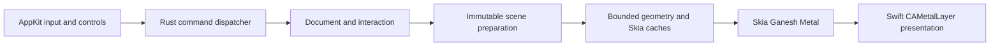

# Task 020: macOS Skia integration contract

Starting implementation: `f5e860c`, descendant of `codex/github-pages`. This is the
production migration, not an import of the comparison branch. Existing AppKit controls,
input semantics, accessibility and shared Rust command dispatch remain unchanged.

## Ownership and boundaries

The main thread initially owns the editor and Skia Ganesh/Metal context. Drawing is
scheduled outside input callbacks. Swift owns CAMetalLayer, device, command queue,
drawable acquisition and presentation. Rust owns immutable scene preparation, paths,
Skia resources and committed-image caching. Present on the same Metal queue after a
nonblocking Skia flush. No GPU completion wait, disk operation or per-sample log on input.

Core exposes `ApplicationSession::render_scene(&mut SceneCache, RenderViewport)` and
the corresponding EditorSession method. The result owns immutable committed geometry
references, a separate live stroke, scene identity and optional ordered transform preview.
Exact Rust field declarations are owned by the core worker and published before renderer
consumption. No Skia types enter core. Preserve the portable scene query and existing ABI.

Cache local f64 geometry by session and committed stroke ID; transforms are metadata.
Committed samples and brush are immutable for an ID in one session. Never retain drafts
under committed IDs. Cache ordered metadata by committed revision and visible descriptors
by viewport; unchanged-revision/viewport ink frames reuse the committed Arc root without
traversing committed samples. Revision changes may scan metadata. Bound retained geometry
and prepared output separately; oversized output fails explicitly, never draws partially.
Start with 32 MiB retained geometry and 64 MiB prepared geometry, configurable in tests.
Culling includes transformed stroke bounds and antialiasing margin. Geometry remains f64;
Skia paths use a stable local origin and f64 viewport-relative translation before narrowing.

## Renderer boundary

New `sketch-renderer` crate owns Skia composition and CPU reference tests. Pin skia-safe
0.153.3 with its standard default features plus Ganesh and Metal on macOS. The owner
explicitly chose the standard build on October 16 rather than minimizing features, to
allow future Skia use. Record the resolved feature set and resulting size; do not turn
size reduction into an acceptance requirement. Narrow objc2/objc2-metal bindings are
approved for native object ownership and actual texture/device validation.
The renderer worker owns Cargo manifests/lockfile, dependency-policy review and the
additive `sketch_renderer_v1.h` ABI. No authored C++ implementation is introduced.

The ABI provides create(device, queue), draw(runtime, session, renderer, texture,
request, stats), reset and free. Publish the exact header before Swift implementation.
Requests carry structure size, expected session/revision/scene generation, monotonically
increasing surface generation, logical/pixel size, viewport and native-resolved adornment
colors. Validate all fields and reject stale requests before resource mutation. Handles
are owner-thread checked; panic containment poisons the renderer without corrupting editor
state. Texture borrowing ends after submission. Device/queue remain retained for context
lifetime. Reset drops disposable resources and advances context generation.

Committed background and live geometry compose atomically from one snapshot. Actual and
predicted samples form one filled stroke. Transform previews retain original order;
initially redraw the visible ordered scene during transforms. Cache keys include session,
revision, viewport, pixel size, color and context generation. Selection/focus use native
semantic colors and logical-point sizes. No silent Core Graphics production fallback.

Bound application path retention to 32 MiB, Skia resource cache to 64 MiB and background
image storage to 64 MiB. An oversized background bypasses that cache, never its validation.
Swift permits at most two frames in flight and one coalesced pending repaint. Check slots
before acquiring drawables; hidden views stop scheduling. A missing drawable preserves
state and does not spin. Track acquisition time because nextDrawable can still stall.

## Evidence and acceptance

Acceptance IDs: SKIA-VISUAL-001, SKIA-ALPHA-001, SKIA-COMMIT-001,
SKIA-INVALIDATE-001, SKIA-VIEWPORT-001, SKIA-SURFACE-001, SKIA-NATIVE-001.
Map these to executable tests; their presence is not evidence of a pass. CPU fixtures cover
cached/reference equality, opacity/order, prediction/cancel/commit, undo/delete/new session,
eviction/reset, viewport edges and large coordinates. Preserve failures and image diffs.

Record scene time, drawable acquisition, CPU submission, cache counts/bytes, outstanding
frames, request/sample age and available presentation timing in bounded diagnostics.
Release comparisons use identical geometry/input/canvas/cache policies. Software timings
do not establish physical pen-to-screen latency. Foreground native tests, designer runtime
inspection and GPU benchmarks require a new explicit desktop reservation. Other platforms
remain documented migration gaps; no new controls or platform rendering rollout is included.
