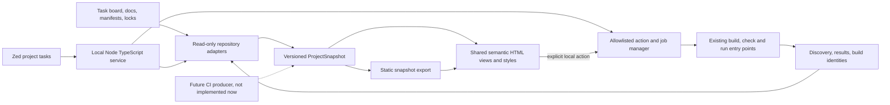
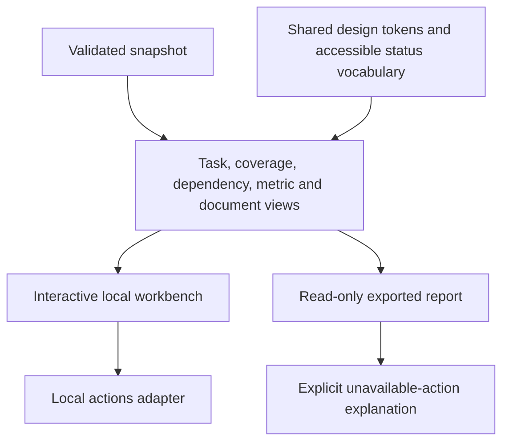
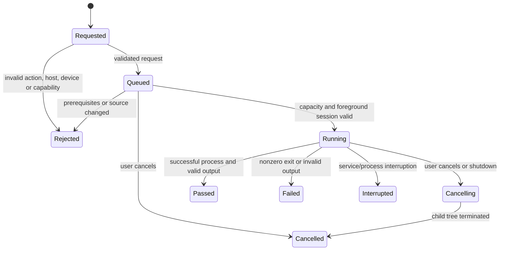

# Project workbench and Zed integration

Implementation plan, 2026-10-16. Owner authorized planning and implementation after the
architecture work, project-scoped dependencies and local Zed development setup. No CI,
release publishing, account setup or global security changes are in scope.

## Outcome and integration choice

One project-specific GUI makes documentation, task dependencies, feature verification,
builds, runs and relevant metrics discoverable. It reads the same authoritative files
used by agents and checks; it does not introduce another manually maintained task board.
Technical implementation, executed verification and owner acceptance stay separate.

Zed's documented extension capabilities cover languages, debuggers, themes, snippets and
MCP servers; they do not expose a general custom application panel. The initial integration
therefore uses project-local Zed tasks to start the workbench and existing build/test commands.
The GUI runs on loopback in a browser. Do not invent a fake language server or fork Zed merely
to embed a panel. If a supported panel API appears later, it can consume the same snapshot
and action service. A thin MCP extension is optional follow-up only when it adds a useful
workflow; it is not required for the first deliverable.

Sources checked: [Zed extensions](https://zed.dev/docs/extensions/developing-extensions),
[tasks](https://zed.dev/docs/tasks), [debugger](https://zed.dev/docs/debugger).

## Architecture

The renderer for this GUI is ordinary semantic HTML and CSS. It does not need Skia.
The drawing-app preview remains the actual independently built Wasm app. The service
uses native Node TypeScript, existing strict type checks, Oxc and Vite. Avoid a UI framework
unless the implementation demonstrates a concrete need. Every source/test/style file stays
within 200 physical lines after formatting, with modules divided by responsibility.

### Shared data and ownership

`ProjectSnapshot` has a schema version, generated time, repository source identity
(commit and dirty diff hash), adapter diagnostics and independent data sections:

- Tasks: original status, dependencies, brief, roles and linked evidence. Owner acceptance
  comes only from board state; a passing test does not change a task to done.
- Documents: repository-relative ID, title, safe content and links. Index approved docs,
  task briefs and project readmes; do not scan home directories or account settings.
- Dependencies: declared direct/transitive package versions, ecosystem and provenance.
  Separate dependency inventory from an actual license/advisory scan result.
- Features: acceptance/invariant IDs, platform requirements, automation implementation,
  discovery, individual attempts and exact source/binary/environment match.
- Quality/metrics: source-size debt, executed check results, package sizes and qualified
  measurements with units, sample counts, configuration and source artifact links.
- Actions: named supported commands, host/device prerequisites, foreground requirement
  and disabled reason. A static snapshot records descriptions but has no execution capability.

Adapters parse existing schemas rather than guessing meaning from prose. Reuse task-board
validation and evidence validation/reporting. New normalized types are plain serializable
data without filesystem paths to private directories or live process objects. Invalid sections
produce visible diagnostics and preserve unaffected sections; malformed data never becomes
an empty successful report. The entire snapshot is bounded by file count/size and total bytes.

Local-only state owns jobs, action authorization and process lifetimes. It is never embedded
in an exported snapshot. Jobs retain the source identity captured at launch, exact executable
and argument list, timestamps, bounded output, exit/signal status and artifact references.
Source changes while a job runs are visible as changed/stale evidence, never silently current.

### Reusable presentation

Both modes use the same view modules and design tokens. Static export includes all necessary
assets and a validated snapshot; it works without the local service and does not run commands.
No CI workflows or external hosting are created by this task. Later CI can invoke the snapshot
producer and export command without recreating the GUI or parsing terminal output.

## Screens and behavior

1. **Overview:** current source identity, platform, technical progress and actionable gaps.
   Link to the exact evidence behind each result. Avoid a misleading aggregate quality score.
2. **Tasks:** filterable list plus dependency graph. Selecting a task shows its brief,
   prerequisites, responsibilities and evidence. Provide an equivalent keyboard-accessible
   table and distinguish waiting for owner acceptance from missing implementation.
3. **Docs:** searchable titles/content, navigation and rendered Markdown. Links stay confined
   to approved repository documents or clearly identified external URLs. Source code is text.
4. **Dependencies:** ecosystem/version table, direct/transitive distinction and dependency
   boundaries. Missing or stale inventory is explicit; advisory findings require a real scan.
5. **Coverage:** feature × platform matrix, then acceptance cases and individual attempts.
   Distinguish implemented automation, discovered tests, executed pass/failure, stale results,
   invalid environment, retries/flakiness and hardware gaps. Do not count replay as native E2E.
6. **Actions and jobs:** supported build/check/run actions, precise host/device eligibility,
   running queue, bounded logs, cancel and artifacts. Show failure reasons and recovery steps.
   A command preview is generated from the same allowlisted definition that execution uses.
7. **Metrics:** source limits, artifacts and measured performance, with scope and units.
   Missing measurements show missing, not zero. Historical invalid runs remain visible and
   excluded from accepted summaries. No fabricated score, budget or physical-latency claim.

The Wasm preview is reached from the web platform/action detail. It identifies the build source
and whether the app is stale. It uses an isolated origin or sandbox without access to the action
service's credentials; preview code cannot trigger local builds or read unrelated files.

Use semantic headings, landmarks, native buttons/inputs/tables, visible focus and text status
labels in addition to color. Graphs have readable list equivalents; narrow layouts preserve
all important actions. Light/dark appearance follows the browser preference without changing
system settings. Loading, empty, malformed, disconnected and unavailable states are deliberate.
The designer's [interaction specification](design/development-workbench.md) defines the
concrete layout, state wording, responsive behavior and authoritative DX acceptance IDs.

## Actions and local execution

Use existing `scripts/build.ts`, `check.ts`, `run.ts`, `test-evidence.ts` and `test-e2e.ts`
through executable/argument arrays. The browser submits an action ID and validated finite
parameters, never shell text, arbitrary paths or environment variables. Do not expose merge,
publish, secret management or system permission operations. A failed check remains failed;
the GUI does not rewrite baselines or auto-retry until green.

Start with one build/test job per checkout and exclusive native UI/GPU ownership per host.
Read-only snapshot loading may continue. Bound queued jobs, history, output bytes and process
duration; preserve a truncation notice and full artifact path when supported. Cancel terminates
the owned process tree with a bounded graceful period before escalation, never unrelated tools.
Shutdown reports interrupted jobs and cannot leave a hidden native test running.

Background commands need no foreground reservation. Run/UI/benchmark actions require an
explicit bounded desktop session in the workbench, exact simulator/device selection and
revalidation at dequeue time. No arbitrary emulator selection. During the owner's current
absence, do not use computer-control app access or trigger permission prompts. Unsupported
hosts show why they cannot run here and the applicable documented command; no false success.

The local service binds only loopback, validates Host and Origin, and uses an ephemeral
capability plus CSRF protection for mutations. Do not place tokens in logs, exported reports,
preview URLs or referrers. Reads and artifact downloads are root-confined with realpath/symlink
checks and explicit allowlists/size limits. Markdown disables raw active HTML and sanitizes
URLs. Render logs as text. Report data and repository content are untrusted inputs to the GUI.

## Zed and native IDE integration

Add `.zed/tasks.json` entries that call existing Node entry points with project-root working
directories. Include workbench start, snapshot/export, background check, platform build and
explicitly labeled native run/test preparation. Do not auto-run foreground tests on opening
the project. Existing Zed debugger/test capabilities remain available independently.

Provide copyable build/test commands and source links; optionally open an existing Xcode,
Android Studio or Zed project through a small reviewed action. Do not simulate their toolbar
buttons or install extensions merely to make a link work. The initial GUI launches tools through
the established scripts; a deeper IDE-specific test adapter needs its own compatibility proof.

## Implementation slices and acceptance

The lead's [version 1 implementation contract](architecture/025-workbench-contract.md)
freezes shared data, endpoint, job, security and offline-export boundaries before writers
start. Current foreground actions are disabled server-side during the owner's absence.

| Slice | Owner and paths | Acceptance/evidence |
| --- | --- | --- |
| W1 Contract and adapters | Lead/build_reliability; `scripts/workbench/model/`, snapshot CLI | Real repo and disposable malformed fixtures; schema/version/size/source identity; honest missing data |
| W2 Actions and jobs | build_reliability; `scripts/workbench/server/`, jobs/action modules | Allowlist, host/device checks, CSRF/Origin/Host, traversal/symlink, cancellation, output flood and process cleanup tests |
| W3 Shared GUI | assigned web implementer; `apps/workbench/` | Browser E2E for navigation, filters, graph/table, docs safety, coverage details, job failure/cancel and isolated preview |
| W4 Reusable export and Zed | Lead/integrator; export CLI, `.zed/tasks.json`, docs | Offline static export with same UI; action-disabled state; tasks validated; actual Zed launch only when no permission prompt is needed |
| W5 Review packet | designer/reviewer | Responsive keyboard/light/dark inspection, independent security/ownership review, exact build/test identity and remaining limits |

Agree the snapshot/action contract before concurrent writers. Use isolated worktrees, at most
two implementation writers and three agents. Keep the workbench one feature in flight after
the architecture's available local acceptance work; external-host gaps remain documented rather
than blocking all useful local work or being relabeled as complete.

Required acceptance IDs: DX-NAV-001, DX-SOURCE-001, DX-TASK-001, DX-DOC-001, DX-DEP-001,
DX-COVERAGE-001, DX-ACTION-001, DX-FOREGROUND-001, DX-JOB-001, DX-PREVIEW-001,
DX-METRIC-001, DX-EXPORT-001, DX-ZED-001 and DX-ACCESS-001. Register executable tests and named
platform requirements. Browser E2E uses the real built GUI and disposable project fixtures;
it is separate from Node adapter tests and from drawing-app native acceptance.

Deliver a locally running workbench, repeatable start/export commands, Zed task integration,
test results and a concise limitations report. Keep changes on the task branch for owner
merge approval. No release or remote CI deployment is included.
