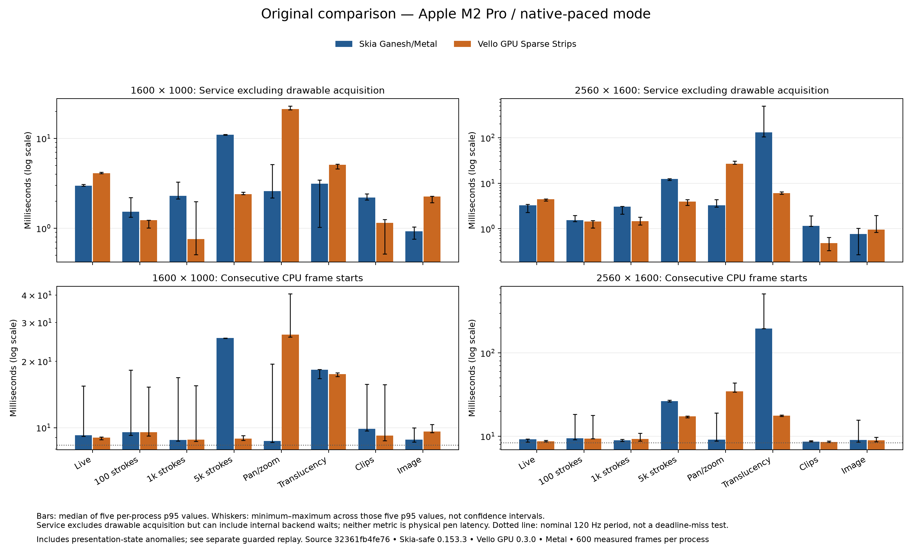
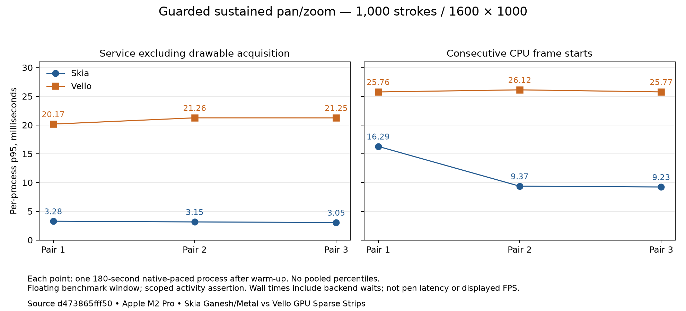

# 002 renderer comparison: Skia Ganesh/Metal and Vello GPU

Status: comparison ready for review; original matrix and guarded replay complete. Production renderer selection remains OPEN.
Date: 2026-10-14.

## Result and recommendation

**Recommendation: retain Skia as the next interaction-prototype baseline, keep Vello GPU
as an active candidate, and leave the production selection OPEN.** Skia has substantially
lower pan/zoom and live-update submission costs in this adapter. Vello has lower retained
dense-scene costs. High-resolution translucency strongly favors Vello in the original data,
and the separate guarded replay confirms that direction. Original Skia timing extremes
were reduced in the replay; the original anomalous magnitudes are not intrinsic ratios.

This is a workload tradeoff, not a universal winner. Light scenes are often dominated by
presentation waits. Neither library has been tuned into a production drawing architecture.
A follow-up should compare a retained base scene plus incremental live overlay, dirty-region
invalidation, transform caching and a presentation schedule that acquires drawables later.
The owner should approve that scoped integration direction before a permanent choice.

This is an isolated experiment. The existing application continues to use its prototype
painters; no production renderer abstraction or permanent backend integration was added.

## Tested implementation and host

The original measured release build is `32361fb4fe76281df509f364cf62b2433876a013`.
The guarded replay uses `d473865fff50c3564192df1c766eedfb200c6980`. Both have a clean
build-time diff. Their binaries are retained separately; later tooling/documentation commits
do not change those measured executables.
Every process manifest records the source, experiment tree and Cargo.lock hashes, compiler,
SDK, flags, runtime and display observations.

- Apple M2 Pro, 12 CPU cores, 16 GiB unified memory; Metal GPU.
- macOS 27.0.1 (26A434), macOS SDK 27.0, Rust 1.99.0 and Swift 6.4.
- Nominal display refresh 120 Hz, backing scale 2; physical render targets 1600×1000 and
  2560×1600. Nominal refresh is not an observed presentation-rate measurement.
- AC power. Power/thermal observations are retained before and after every process.
  “No warning recorded” does not establish a temperature or absence of throttling.
- No concurrent agent builds, GPU experiments or native UI automation during the matrix.
  Existing user applications and OS services remained open. This is a live desktop,
  not an isolated laboratory machine; process variation is part of the evidence.
- Temporary sleep/display inhibition applies only while the runner is alive.

The original experiment source-tree SHA-256 is
`e4328f675a82c91d6682b9ccac951dba3ef72a475db85613b6fa055c3b2da287`;
Cargo.lock SHA-256 is
`0e0e0a7f245607495664d2ee6887568c5c9b70c989e340c2c40bc6e94b21cc88`.
Rust uses the release profile; Swift uses `-swift-version 5 -O`.
Skia's selected native archive is
`skia-binaries-b7f043e0b1e2a850e702-aarch64-apple-darwin-ganesh-jpegd-jpege-metal-pdf.tar.gz`,
SHA-256 `59ac182e5b81445ba8bb84c5a65468e3aec7b6ee1b642868603a3725f29a1059`.
The manifest records the resolved dependency identities as well as these build identities.

| Candidate | Exact experiment variant |
| --- | --- |
| Rust-Skia `skia-safe =0.153.3` | Ganesh over Metal; upstream binding reference `m153-0.101.2` |
| Vello GPU `vello_gpu =0.3.0`, `vello_common =0.3.0` | Sparse Strips: CPU path preprocessing, GPU rasterization/compositing |
| GPU access | `wgpu =30.0.0`, locked internals at 30.0.1; Metal only |

The Vello choice follows the upstream renderer-family guidance; it is not a measurement
of compute-centric `vello =0.8.0` or Vello CPU. See the
[experiment README](../../experiments/renderer-comparison/README.md),
[locked dependencies](../../experiments/renderer-comparison/Cargo.lock), and
[upstream renderer guidance](https://github.com/linebender/vello#choose-a-renderer).

## What is compared

Both adapters consume actual `sketch-core::Editor::render()` outlines. Each whole stroke
is one nonzero fill; overlapping component polygons are not blended separately. Geometry,
input traces, transforms, decoded image bytes and per-frame expected state identities are
matched. Final actual geometry is independently rehashed outside timing.

Both use the same Metal device/queue, tracked BGRA8Unorm offscreen target, native final
blit and CAMetalLayer presentation policy. Output is freshly rasterized every frame.
Immutable vector scenes/resources are retained. Skia retains paths and changes its matrix
for pan/zoom; Vello must reprocess its pixel-space strips after transform changes. Live
stroke updates rebuild scene geometry under the declared policy. This is not a benchmark
of an optimized dirty-region, tiled or separately cached live-overlay implementation.

Both use source-over blending and analytic coverage at sample count 1, with bilinear image
filtering and no mipmaps. Identical sample counts do not establish identical antialiasing
quality. Images start as identical straight-alpha RGBA bytes and use a premultiplied target.
Channels use numeric sRGB values, without a linear-light conversion. Readback happens after
timed rendering. The final native window may scale the canvas for display; PNGs contain the
actual requested physical render size.

Eight workloads cover six scene classes: live stroke over 100 committed strokes; static
100, 1000 and 5000 strokes; a 1000-stroke pan/zoom trace; 256 overlapping translucent
outlines; bounded nested clips; and a decoded 2048×2048 image with vector overlay/scale.
These are experiment workloads, not supported product limits.

## Protocol and timing definitions

The original matrix completed all **320 primary processes** (eight workloads × two
resolutions × two modes × five pairs) and **six 180-second sustained processes**.
There are 192,000 primary and 70,354 sustained measured frames, with common GPU timeline
spans for every measured frame. Primary suite wall time was 76.9 minutes, including
initialization, output and readbacks; this is execution cost, not rendering throughput.
An independent audit reproduced both analyzer summaries exactly and verified all 326
source/geometry identities. Each primary backend/cell has an identical final RGBA hash
across its five repetitions. Eighteen calibration and sixteen additional quality processes
are separate from that matrix.

**Presentation-state caveat:** 3,881 primary and 4,290 sustained presentation callbacks
are missing. Nine original primary trials have callback outages lasting at least one
second, and all three Vello sustained trials have extended outages. One second is a
post-hoc diagnostic grouping, not an acceptance threshold or inferred deadline count.
The original host did not record full occlusion/session activity or assert benchmark
activity. These trials are retained, and a repaired-host replay is reported separately.
The original matrix is complete as collected data; it is not an uncontaminated certification
of native display pacing.

Primary trials use one first-use frame, 120 warm-up frames and 600 measured frames in
fresh processes. Five paired trials per workload/resolution/mode alternate backend order.
Warm-up and measured state indices reset independently. Live input cycles over 240 samples;
pan/zoom follows a 600-transform cycle. No wall-clock backlog can skip input or geometry.

Completion mode retires each frame before proceeding. Native-paced mode permits two frames
in flight with display synchronization. Even completion mode acquires/presents real native
drawables and can wait for the compositor; it is not a pure offscreen throughput benchmark.
The shared adapter acquires a drawable before backend scene preparation. A CPU-heavy
backend therefore holds that drawable during preparation. Alternative scheduling that
overlaps preparation with display waits was not tested; these numbers describe this
common pipeline, not each library's best attainable application frame graph.

Sustained trials use pan/zoom at 1600×1000 in paced mode for 180 measured seconds after
120 warm-up frames: three pairs, six processes. The frame-indexed trace advances once per
submitted frame. Faster processes traverse more cycles; shared prefixes must match.

| Reported quantity | Meaning and limit |
| --- | --- |
| CPU stage durations | Wall time on the submitting thread: input, outline generation, scene preparation, drawable acquisition, rendering/flush/submission, presentation enqueue and completion waits. Backend calls can internally wait. These are not CPU-utilization counters. |
| Service | After prior-frame retirement, from input through presentation enqueue. Includes drawable acquisition; excludes hashing, readback, output and explicit retirement waits. |
| Service excluding acquisition | Per-frame `service_ms - acquire_ms`. Removes the common drawable wait, but still includes synchronous backend waits. It is not pure CPU execution. |
| CPU frame interval | Consecutive frame-start timestamps, including retirement backpressure and host scheduling. |
| GPU timeline span | Common Metal begin marker before backend scene preparation through the shared final blit command's GPU end. Includes CPU preparation/submission gaps and queue scheduling. Not pure GPU pass execution; do not add it to service time. |
| Presentation interval | Consecutive positive `MTLDrawable.presentedTime` callbacks. Missing callbacks can span multiple frames. A present call returning does not prove display. |
| Service-budget overrun | Service exceeding 1000/120 ms, with its sample denominator. It includes acquisition waits and is not a missed-display-deadline count. |
| Memory | OS process peak RSS, an external 250 ms RSS sampler, and a Metal allocation snapshot at finish, separately. GPU peak residency and physical footprint are unsupported. Unified-memory counters must not be summed. |

All quantiles use nearest rank within a process. Cell tables summarize the five per-process
statistics and preserve paired ranges; frames are never pooled into one headline percentile.
With 600 samples, p99 has few tail observations. Small/mixed differences are inconclusive.
Actual display deadline misses and physical pen-to-screen latency are **not measured**.

Process initialization includes common fixture construction/image decoding and, for live
ink, precomputation of 240 expected geometry identities. This warms common CPU code before
first use. GPU first-use construction/upload remains separately recorded. These are fresh
process results, not guaranteed cold filesystem/driver-cache or cold-core results. The
first-ever shader startup smoke is excluded from the frozen matrix.

OS/sample memory includes the host, shared fixture/editor, both linked libraries, retained
measurement rows/callback state, and untimed final readback/PNG output. The image fixture is
decoded in common setup even for other workloads. Sustained row storage grows with frame
count and is recorded in each manifest; faster runs therefore retain more instrumentation.
No counter is represented as isolated renderer memory or final product memory.

## Instrumentation calibration

| Backend | GPU marker off − on: active-service p50 range, ms | RSS sampler off − on: range, ms |
| --- | ---: | ---: |
| skia | -0.494 to +0.051 | -0.314 to -0.108 |
| vello | -0.061 to +0.060 | -0.036 to +0.327 |

Here active service means service excluding drawable acquisition. Signs and magnitudes vary
across ordered rounds on the live desktop. This does not establish a causal instrumentation
overhead or prove negligible overhead; no correction is subtracted from the results.


Three ordered pilot rounds separately disable the GPU begin marker or external memory
sampler. The marker-off path preserves render/blit/present/retirement work and writes empty
GPU fields with `calibration-disabled`. It is not a completely uninstrumented build: raw
frame rows and other bookkeeping remain. Primary/sustained runs require profiling on;
analysis rejects mismatched profiling modes. Calibration data is not pooled into the matrix.

## Visual comparison

[1600×1000 frame-150 comparison sheets and statistics](renderer-comparison/frame150-1600/visual-statistics.json)
and [2560×1600 frame-599 sheets and statistics](renderer-comparison/frame599-2560/visual-statistics.json)
retain eight pairs each, with amplified RGB differences. The high-resolution images come
from the original primary completion-mode repeat 0; the intermediate images are separate
quality captures. The image helper rejects mismatched frame, dimensions, geometry/input/image
identities and nonopaque readbacks. Pixel differences are calculated at source resolution;
sheets scale images for readable presentation.

The designer also reviewed all eight high-resolution frame-599 sheets and the live originals.
No additional correctness blocker was found. The viewing tool downsampled the large original
images, so this is not exhaustive one-to-one pixel inspection.

The designer reviewed all eight matched fixture pairs at frame 150 and 1600×1000. Visible
geometry placement, pressure widths/caps, stroke order, translucent interiors, curved clip
boundaries, image orientation and compositing agree; no visual correctness blocker was
found. Edge coverage differs, especially in dense scenes, and image filtering/boundaries
show faint differences. These outputs are **not pixel equivalent** or certified equal quality.

Static images do not establish temporal smoothness, every live-frame union, all clipping
combinations, source-image colorimetry or physical pen feel. The visible clip boundary is
predominantly curved, so this fixture does not independently certify every rectangular or
nested clipping case. Pixel-error statistics are descriptive, not acceptance thresholds.

## Repeated and sustained results

**Original matrix, before the lifecycle repair.** Values below are the median of five
per-process p95 values, in milliseconds. `S / V` means Skia / Vello. These are wall-clock
submission and frame-start timings, not pure CPU execution or displayed FPS.

### 1600×1000, native-paced

| Workload | Service excluding acquisition, S / V | CPU frame interval, S / V | GPU timeline span, S / V |
| --- | ---: | ---: | ---: |
| alpha | 3.12 / 5.09 | 18.32 / 17.48 | 11.60 / 10.41 |
| clip | 2.19 / 1.15 | 9.87 / 9.22 | 2.42 / 0.98 |
| dense100 | 1.53 / 1.23 | 9.55 / 9.55 | 2.43 / 2.10 |
| dense1000 | 2.30 / 0.76 | 8.78 / 8.81 | 5.67 / 1.21 |
| dense5000 | 10.97 / 2.40 | 25.50 / 8.91 | 17.44 / 5.94 |
| image | 0.92 / 2.26 | 8.83 / 9.62 | 0.96 / 2.40 |
| live | 2.97 / 4.10 | 9.23 / 9.01 | 2.73 / 3.83 |
| panzoom | 2.59 / 21.11 | 8.71 / 26.39 | 6.19 / 21.76 |

### 2560×1600, native-paced

| Workload | Service excluding acquisition, S / V | CPU frame interval, S / V | GPU timeline span, S / V |
| --- | ---: | ---: | ---: |
| alpha | 130.63 / 6.03 | 195.72 / 17.57 | 192.41 / 14.94 |
| clip | 1.15 / 0.48 | 8.62 / 8.52 | 1.94 / 1.10 |
| dense100 | 1.54 / 1.43 | 9.41 / 9.39 | 3.76 / 2.20 |
| dense1000 | 3.05 / 1.47 | 8.94 / 9.28 | 7.08 / 2.43 |
| dense5000 | 12.31 / 3.94 | 26.28 / 17.29 | 24.04 / 8.59 |
| image | 0.76 / 0.95 | 8.97 / 8.91 | 0.94 / 2.80 |
| live | 3.26 / 4.44 | 9.19 / 8.65 | 3.72 / 4.72 |
| panzoom | 3.27 / 26.77 | 9.07 / 34.48 | 7.32 / 28.13 |



Skia's pan/zoom submission advantage is consistent across all five original high-resolution
pairs: Vello minus Skia p95 service excluding acquisition is +22.38 to +27.54 ms. Live-update
pairs are +1.00 to +1.82 ms. For retained dense5000, Vello is lower by 7.56 to 8.75 ms.
Tiny light-scene differences should not drive selection: acquisition and compositor pacing
often dominate them. The large high-resolution alpha magnitude must be read with the
original callback-outage caveat and the repair replay, not advertised as an intrinsic ratio.

Completion-mode distributions are preserved for all sixteen workload/resolution cells in
the linked JSON/CSV. They include GPU retirement backpressure and remain separate from
native-paced results; no pooled cross-mode score is calculated.


### Original sustained runs

| Backend / repeat | Frames in ≥180 s | Service excluding acquisition p95, ms | CPU frame interval p95, ms | First → last 30 s interval p95, ms | OS peak RSS, MiB |
| --- | ---: | ---: | ---: | ---: | ---: |
| skia / sustained-0 | 19,109 | 2.71 | 16.72 | 16.72 → 16.78 | 196.2 |
| vello / sustained-0 | 4,768 | 81.81 | 110.93 | 28.41 → 128.39 | 205.7 |
| vello / sustained-1 | 6,916 | 21.21 | 29.94 | 27.39 → 29.76 | 211.7 |
| skia / sustained-1 | 16,136 | 4.47 | 19.02 | 19.56 → 17.78 | 201.5 |
| skia / sustained-2 | 16,638 | 4.00 | 17.63 | 9.58 → 16.94 | 203.0 |
| vello / sustained-2 | 6,787 | 21.64 | 33.41 | 33.78 → 33.17 | 211.0 |

Vello repetition 0 has a material unexplained slowdown. Callbacks stop at measured 66.69 s;
scene preparation slows later, abruptly around frame 4092 / 107.713 s. First-to-last 30-second
scene-preparation p95 rises from 21.79 to 92.49 ms. Rendering/submission and presentation-enqueue
also inflate, while explicit completion waits remain negligible. The common GPU timeline
contains CPU gaps, so its growth is not proof of slower GPU execution.

The slowdown is not reproduced at the same trace cycle in the other two runs. Sampled peak
RSS is lower in this run than in the other Vello runs. This does not identify App Nap,
contention, throttling or a renderer leak. All three Vello runs have extended callback
outages, including runs without comparable CPU degradation. There is insufficient evidence
to attribute the anomaly to Vello or claim stable sustained throughput. Repaired-host
results below supersede these runs for the guarded native-window experiment.

The external Python memory sampler and native frame timestamps use different monotonic
epochs. Only process-relative memory profiles can be compared; precise time alignment
between an individual frame and RSS is unsupported in the original dataset.

### Lifecycle repair and separate replay

The guarded host holds a scoped activity assertion through rendering/output, invalidates
full occlusion/session/sleep/surface changes and records lifecycle state. Automated trials
use a temporary floating window (AppKit level 3), restored after output; interactive launches
remain normal. This is a controlled symmetric presentation condition, not production-window
certification. The renderer/input/quality settings did not change. Startup waits two seconds
before initialization. The final host status overrides a prematurely complete renderer
manifest if an interruption occurs during output; invalid CLI runs return nonzero.

All **16 affected primary trials** and **six sustained trials** completed at
`d473865fff50c3564192df1c766eedfb200c6980`. They are analyzed separately from the original
matrix. Failed attempts remain on disk: early occlusion, two operator-confirmed minimizations
and a later full-occlusion interruption. Complete pairs were recovered into derived suites
with explicit source hashes and exclusions. An unmatched successful Vello run from an
interrupted pair is excluded, and both members of that pair were rerun. No slower complete
trial was silently replaced. See [guarded replay JSON](renderer-comparison/guarded-replay.json).

#### Affected primary paired replays

Per-process p95, milliseconds. Each row is one paired repetition, not a five-run aggregate.
`S / V` means Skia / Vello. The differing original and guarded presentation conditions prevent
attributing every change solely to the activity assertion or window level.

| Workload / pixels / mode / repeat | Original CPU frame interval, S / V | Guarded CPU frame interval, S / V | Guarded service excluding acquisition, S / V |
| --- | ---: | ---: | ---: |
| dense100 / 1600 / paced / primary-4 | 18.25 / 9.18 | 9.01 / 9.52 | 0.78 / 1.03 |
| dense100 / 2560 / paced / primary-0 | 18.24 / 17.82 | 10.62 / 8.60 | 1.47 / 0.50 |
| dense100 / 2560 / paced / primary-1 | 15.85 / 9.33 | 9.45 / 9.59 | 0.61 / 0.65 |
| alpha / 2560 / completion / primary-2 | 154.67 / 18.17 | 160.11 / 13.87 | 104.79 / 5.78 |
| alpha / 2560 / completion / primary-3 | 523.96 / 17.74 | 177.13 / 15.41 | 113.83 / 6.71 |
| alpha / 2560 / completion / primary-4 | 190.50 / 19.71 | 173.97 / 17.09 | 114.40 / 6.70 |
| alpha / 2560 / paced / primary-0 | 514.70 / 17.86 | 186.67 / 17.62 | 115.80 / 6.33 |
| alpha / 2560 / paced / primary-1 | 219.68 / 17.93 | 156.99 / 17.66 | 104.07 / 6.33 |

The guarded high-resolution alpha pairs still strongly favor Vello under this adapter:
completion-mode CPU frame p95 is 160–177 ms for Skia versus 14–17 ms for Vello; the two
paced pairs are 157–187 ms versus about 18 ms. This supports a workload-specific finding,
not a claim about every transparent drawing or an optimized alternative Skia cache policy.

#### Guarded sustained runs

| Backend / repeat | Frames in ≥180 s | Service excluding acquisition p95, ms | CPU frame interval p95, ms | First → last 30 s interval p95, ms | OS peak RSS, MiB |
| --- | ---: | ---: | ---: | ---: | ---: |
| skia / sustained-0 | 20,331 | 3.28 | 16.29 | 16.54 → 9.44 | 205.0 |
| vello / sustained-0 | 7,186 | 20.17 | 25.76 | 25.38 → 26.07 | 212.2 |
| vello / sustained-1 | 7,168 | 21.26 | 26.12 | 26.35 → 25.68 | 207.0 |
| skia / sustained-1 | 21,385 | 3.15 | 9.37 | 9.43 → 9.47 | 189.2 |
| skia / sustained-2 | 21,313 | 3.05 | 9.23 | 9.41 → 9.25 | 198.4 |
| vello / sustained-2 | 7,175 | 21.25 | 25.77 | 25.63 → 27.46 | 204.9 |

Across the three guarded sustained processes per backend, the median process p95 of service
excluding acquisition is **3.15 ms Skia / 21.25 ms Vello**; CPU frame interval is
**9.37 / 25.77 ms**. Skia's interval p95 varies from 9.23 to 16.29 ms, so display pacing is
not uniformly stable. Vello's process interval p95 is 25.76–26.12 ms; its earlier severe
late-run degradation did not recur. These are wall-clock pipeline measurements, not physical
input latency or displayed-FPS measurements. They support the pan/zoom direction without
establishing the original slowdown's cause.

Guarded telemetry is still incomplete: **25 of 9,600 primary callbacks and one
of 84,558 sustained callbacks are missing**. Skia primary 227 includes 11 consecutive missing callbacks: their CPU frame-start
span is 1.458 seconds, bracketed by positive callbacks 1.818 seconds apart, while
lifecycle checks remained valid. Neither span proves a display outage. The guards do not prove every frame was displayed or
eliminate every presentation-timing gap. All three guarded Vello sustained runs have a
callback for every measured frame. No deadline-miss rate is inferred from missing callbacks.




### Process first use and memory

Original 2560×1600 completion-mode medians over five fresh processes. `S / V` is Skia / Vello.
First-use service excludes explicit GPU retirement. RSS is whole-process peak, including
untimed output; it is not an isolated renderer cost.

| Workload | Initialization, ms S / V | First-use service, ms S / V | OS peak RSS, MiB S / V |
| --- | ---: | ---: | ---: |
| alpha | 78.9 / 89.8 | 100.7 / 39.4 | 739.6 / 212.7 |
| clip | 79.7 / 91.4 | 12.4 / 9.5 | 136.3 / 136.8 |
| dense100 | 76.7 / 78.3 | 6.5 / 5.8 | 161.6 / 163.3 |
| dense1000 | 83.1 / 90.7 | 31.4 / 49.7 | 189.3 / 214.2 |
| dense5000 | 78.2 / 90.1 | 72.3 / 180.9 | 528.1 / 603.0 |
| image | 80.6 / 89.9 | 8.4 / 8.1 | 186.8 / 154.5 |
| live | 1077.3 / 1072.8 | 5.3 / 5.2 | 209.1 / 190.3 |
| panzoom | 68.3 / 76.1 | 24.8 / 46.0 | 197.1 / 211.9 |

Live initialization includes roughly one second of common identity precomputation. Dense5000
shows a first-use and memory cost for Vello despite its lower steady retained-scene timings.
High-resolution alpha has much greater Skia allocation/RSS in this adapter; a cache-pressure
explanation remains a hypothesis, not an established cause. The JSON retains first-use
stages, sampled peaks and finish-time GPU allocation separately.


## Integration risks and platform limits

- Rust-Skia adds a native C++ build/binary dependency. The minimal Ganesh/Metal prebuilt
  package returned 404 during setup; JPEG/PDF features were enabled to consume the published
  package. Neither API is exercised. Its release identity/digest is recorded in manifests.
  This is a concrete packaging constraint, not a timed build-speed comparison.
- Vello GPU avoids that Skia package but adds its own CPU preprocessing/resource model and
  pinned wgpu integration. This experiment's transform costs must not be generalized to
  every future Vello variant or optimized application scene strategy.
- Alternative scene caching, renderer tuning and presentation scheduling were not optimized
  independently for each candidate. Results apply to these pinned adapters and the declared
  invalidation policy, rather than a performance ceiling for either library.
- Both use experimental unsafe Metal interoperation in this isolated host. Texture tracking,
  shared-queue ordering, retention, retirement and failure paths were reviewed and exercised;
  that is not a production surface/lifecycle implementation for every native platform.
- macOS/Metal results do not certify iOS/iPadOS, visionOS, tvOS, watchOS, Android/ChromeOS,
  Windows composition surfaces, Linux/Vulkan, or browser Wasm/WebGPU. Each needs target builds,
  actual presentation/input tests, driver/API checks and equivalent measurements. Viewer-only
  devices may use different rendering/preview policies.
- This experiment does not compare final package size, energy consumption, pure GPU pass
  time, GPU peak residency, physical footprint or pen latency. It establishes no universal
  FPS target, supported document limit or universal reference hardware.

## Verification and review

- `./scripts/check` passed at source `32361fb`, including 26 Rust tests, formatting/lints,
  the macOS build and Swift/Rust integration. Evidence helpers/report were untracked at that
  time and do not alter that production check. Existing linker search-path warnings did not
  fail the build.
- The isolated experiment has five passing Rust CPU tests. Its analysis/failure suite had
  twelve passing Python tests at `32361fb`; the release native build passed.
- The build-reliability specialist independently reproduced original and guarded summaries exactly,
  checked 320+6 completeness/identities, all 262,354 GPU spans, repeat readback hashes and
  all eighteen calibration identities. Guarded evidence adds 94,158 GPU-timed measured frames;
  all sixteen guarded primary RGBA hashes match their original counterparts.
- A fresh reviewer identified the presentation-state observability gap. The finding,
  native lifecycle repair and affected paired reruns are retained above. Repaired source
  `d473865` passed the guarded matrix; final source/evidence review verified activity,
  level and paired identities. Sixteen analysis/failure and eight replay-assembly tests
  pass. Review reproduced rejection of truncated raw data, a changed PNG and unguarded
  inputs disguised as guarded evidence. Final independent review of `55cf0b8` plus the
  evidence/helpers found no unresolved actionable finding; it verified the completed
  replay tables, raw hashes, plots and qualified recommendation.
- Analysis figures were generated in an isolated Python environment with pinned packages
  and inspected for labels, units, ranges and readable layout. These scientific plots use
  original data and explicitly show variation; they do not hide anomalous trials.

Native host inspection passed selector locking, responsive cancellation, retry into a fresh
output directory, invalidation on minimize/resize, restoration, native menus/AX labels, and
safe Quit. A default launch from `/` rendered and wrote results successfully after an output
path repair. A wide-window layout issue was repaired and rechecked. Cancelled/invalidated
artifacts stay explicitly incomplete and are excluded from performance results.

Keyboard-event delivery was inconclusive in the computer-control session. Minimum-width
resizing and dark appearance remain unverified. These are explicit host-UI coverage limits;
no global appearance or keyboard preference change is part of the implementation.

## Reproduce and retain evidence

From the repository root on a Metal-capable Mac:

```sh
./scripts/check
./scripts/check-renderer-comparison
./scripts/run-renderer-comparison --suite pilot --output artifacts/renderer-comparison/pilot-new
./scripts/run-renderer-comparison --suite primary --output artifacts/renderer-comparison/primary-new
./scripts/run-renderer-comparison --suite sustained --output artifacts/renderer-comparison/sustained-new
python3 scripts/analyze-renderer-comparison "$PWD/artifacts/renderer-comparison/primary-final"
python3 scripts/analyze-renderer-comparison "$PWD/artifacts/renderer-comparison/sustained-final"
python3 scripts/export-renderer-comparison artifacts/renderer-comparison docs/evidence/renderer-comparison
python3 -m venv .build-cache/renderer-analysis
.build-cache/renderer-analysis/bin/python -m pip install -r scripts/requirements-renderer-analysis.txt
.build-cache/renderer-analysis/bin/python scripts/compare-renderer-images artifacts/renderer-comparison/quality-final --output docs/evidence/renderer-comparison/frame150-1600
.build-cache/renderer-analysis/bin/python scripts/compare-renderer-images artifacts/renderer-comparison/primary-final --output docs/evidence/renderer-comparison/frame599-2560 --width 2560 --mode completion --repeat-id primary-0
.build-cache/renderer-analysis/bin/python scripts/plot-renderer-comparison docs/evidence/renderer-comparison/results.json --output docs/evidence/renderer-comparison
```

Fresh execution directories above deliberately differ from retained evidence. The export
command reproduces this report's original `primary-final`/`sustained-final` evidence and
three `calibration-N-gpu-STATE-rss-STATE` rounds; it requires their full declared counts.
Use fresh directories or a separate checkout rather than overwrite measurements.
Builds may download pinned Rust dependencies and the Skia binary on first use. Raw process
manifests, per-frame CSVs, launcher/power logs, memory samples and final PNGs remain under
`artifacts/renderer-comparison/`. Compact, portable [results JSON](renderer-comparison/results.json),
[per-process CSV](renderer-comparison/per-process.csv), matched image sheets and plots are
committed with this report. The JSON preserves p50/p95/p99/max, five-process ranges and paired
p95 differences. The raw suite summary hash is recorded in the compact export.


The original raw archive is `artifacts/renderer-comparison/renderer-original-32361fb.tar.gz`
(252,586,780 bytes), SHA-256
`ab6db65afa23b3af5c8dc5fb1b61c99e7fc65db417084bb94b87b027d28a4dc2`.
Its [index](renderer-comparison/original-archive.json) records included suites.
The guarded archive is `artifacts/renderer-comparison/renderer-guarded-d473865.tar.gz`,
SHA-256 `85e2e95d62ab082094328677f0a8784646845658cf85418f376755a09461cd32`; its
[index](renderer-comparison/guarded-archive.json) includes derived suites, original attempts
and excluded lifecycle diagnostics. Raw archives
are retained locally rather than checked into Git; compact review evidence is committed.

The guarded replay is reproducible with the same retained binary and fresh output paths:

```sh
./scripts/run-renderer-comparison --suite primary --replay-from artifacts/renderer-comparison/primary-final --trial-indices 58,70,71,72,224,227,228,230,233 --output artifacts/renderer-comparison/primary-guarded-new
./scripts/run-renderer-comparison --suite sustained --output artifacts/renderer-comparison/sustained-guarded-new
```

For the interrupted attempts actually collected here, derive only complete pairs:

```sh
./scripts/assemble-renderer-replay --source artifacts/renderer-comparison/primary-guarded-final --source artifacts/renderer-comparison/primary-guarded-remaining-2 --output artifacts/renderer-comparison/primary-guarded-assembled
./scripts/assemble-renderer-replay --suite sustained --original artifacts/renderer-comparison/sustained-final --source artifacts/renderer-comparison/sustained-guarded-final --source artifacts/renderer-comparison/sustained-guarded-remaining --output artifacts/renderer-comparison/sustained-guarded-assembled
python3 scripts/export-renderer-replay artifacts/renderer-comparison --output docs/evidence/renderer-comparison/guarded-replay.json
.build-cache/renderer-analysis/bin/python scripts/plot-renderer-replay docs/evidence/renderer-comparison/guarded-replay.json --output docs/evidence/renderer-comparison
```

The assembly commands require a fresh output directory, so preserve existing derived suites
or choose a new name and pass it to the exporter's `--primary` / `--sustained` options.
The raw-input SHA-256 map in each export binds the report to actual files; export revalidates
and reanalyzes raw data rather than trusting a stale summary. Image analysis verifies decoded
RGBA digests and final actual/expected geometry state before computing differences.

Superseded smoke, precomputed-hash repair pilots and designer-cancelled runs are retained
under the ignored artifact tree, clearly excluded from the final matrix. Raw files are not
silently discarded or substituted. Production selection and merging into main require owner
approval separately from review of this experiment.
