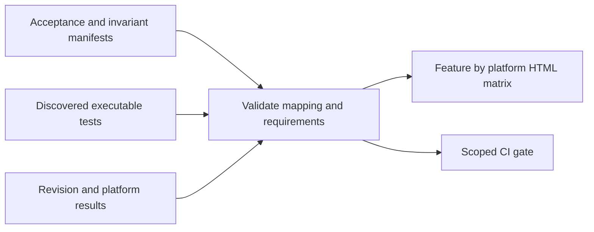

# Feature coverage and E2E evidence

Tasks 015/017 provide the registry and executable Cargo/Node evidence report. Native
macOS drawing/save/reopen now has a passing actual XCTest journey at `50dbeef`; other platform
drivers and broader native journeys are pending. See the [native evidence](../evidence/017-macos-e2e-foundation.md)
for exact test identity, failed development attempts and review limits. The cross-platform
registry maps BRUSH-001 and FILE-001 to that executable journey for macOS only; other
platforms and broader journeys retain gaps. A successful imported execution alone does not change manifest
automation state or certify every platform. The report is not complete passing coverage.
See [runner commands and limitations](evidence-runner.md).

Cargo packages with native effects declare `[package.metadata.native-sketch]`
`test-platform = "host"`. Discovery and execution then record the actual OS; they cannot
claim another host. Unspecified packages retain portable contract-test scope. In particular,
`sketch-services` filesystem and worker results on macOS do not certify Windows or Linux.
Host-scoped Cargo IDs include the OS (`cargo:package:macos:target:test`); portable IDs
retain their previous form. A foreign host cannot collide with a required native test ID.
The service and keyboard manifests map narrower tested cases; they do not promote the
broader persistence, focus or recovery invariants to complete native acceptance.

## Three sources of truth

1. Small JSON feature manifests define acceptance IDs, expected behavior, applicable
   platforms/input types, required test levels, owner, and explicit gaps.
2. Discovered executable tests map stable IDs to those acceptance cases and invariants.
3. Native test artifacts are normalized to results carrying source/build/environment identity.

Use `quality/features/*.json` and `quality/schema/` for manifests/schema; use ignored
artifact directories for raw results and generated HTML/JSON reports. Cargo/Node discovery
uses executable runners. Native XCTest discovery rejects setup errors and empty enumeration;
compiling its test target does not create discovered tests or passing results.

## Record contract

Feature: stable feature ID, description, acceptance cases, applicability, owner task.
Case: observable expected behavior, required levels per platform, linked invariant IDs,
input/device capabilities, test mappings or gap with reason and responsible task.
Requirement: optional complete `coverage` override (`automation`, `testIds`, `gaps`) scoped
to its platform/level/pointer width. Otherwise the case-wide defaults apply. Overrides
replace defaults completely; they must explicitly retain any gap applicable to that row.
Mapping: runner-qualified stable executable test ID, level, platform and fixture identity.
Execution: source revision + dirty diff hash when relevant, binary hash, toolchain/OS/device,
test ID, attempt, status, duration, timestamp, logs/screenshots/traces, environment validity.

Use namespace-qualified test IDs to avoid duplicate names across runners. Separate evidence
of native control existence, accessibility tree inspection, screen-reader speech, real event
delivery, synthetic adapter replay, and physical latency. Do not flatten them into E2E.

| Automation state | Execution state |
| --- | --- |
| Implemented | Passed, failed, flaky, skipped, blocked, not-run-at-revision |
| Planned | No executable test yet |
| Unsupported automation | Named platform/tool limitation and alternative evidence |
| Not applicable | Explicit product/capability reason |

An older passing commit remains historical. Required skipped/missing/blocked/unsupported
coverage cannot produce a passing claim. A deliberate waiver is reported as a limitation
for owner review, not converted to pass. Retain all attempts; a retry pass is flaky.

## Initial acceptance journeys

| Case family | Required user journey |
| --- | --- |
| Brush/ink | Launch, change width/color, draw, verify visible output and saved geometry |
| History | Draw, undo, redo; no sample-level undo entries |
| Selection | Select topmost, transform, cancel/commit, verify original/history |
| Persistence | Save, terminate normal process, relaunch, reopen, compare semantics |
| Focus | Field undo/delete/tool-letter/space does not modify canvas |
| Recovery | Fail save/import, retain content, retry safely; separate process-kill checkpoints |
| Viewers | Open/cache/navigate, reject edits, retain content across source failure |
| Watch sources | Cached launch, bounded phone preference, same-identity network fallback |
| Web | Offline launch, quota/context loss, interrupted asset/version update |

Share acceptance intent and synthetic document fixtures across hosts, not one forced
cross-platform UI driver. Each platform traverses its actual UI/input/bridge/render path.
Use stable accessibility identifiers and explicit readiness conditions rather than sleeps.
Canvas tests use visible output AND document assertions. Calling Rust directly is not
proof that native pointer delivery works. Synthetic pressure replay is not physical pen input.
Test hooks may select fixtures/reset state but must not bypass the behavior claimed.

## Gates and reporting

- Reject duplicate/unknown IDs, orphan mappings and required tests missing from an
  enumerated runner scope. An absent native host enumeration is `missing-discovery`,
  never passing evidence; background reporting does not launch native automation.
- Discover tests from runners; matching a string in source is insufficient.
- Validate test applicability, binary/revision identity and platform against requirements.
- Report coverage dimensions separately: functional, recovery, accessibility, performance,
  input/device and packaging. Avoid a single misleading quality percentage.
- Include evidence links and remaining gaps in the MR report. Do not commit personal data.
- A changed shared contract triggers the affected consumer matrix; a local control change
  need not rerun unrelated GPU benchmarks. Missing required hosts are explicit limitations.
- Never auto-update goldens, skip lists or applicability merely to get a green result.

Implementers own tests/mappings. Designer defines native acceptance. build_reliability
owns schema/runners/reporting. Reviewer assesses whether assertions prove the claim;
registry validation alone cannot establish test quality. No extra test-management service.
