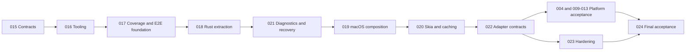
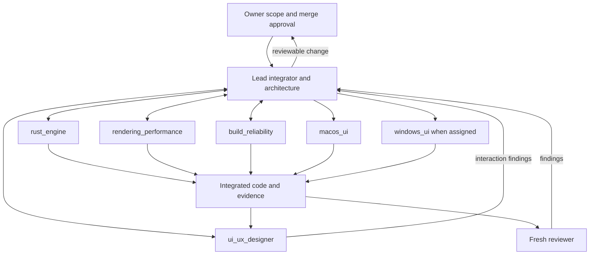

# Architecture and quality refactoring plan

Current execution handoff: [resume instructions and exact stopping point](RESUME.md).

Update 2026-10-16: the owner selected typed FFI with generated declarations to replace
custom command packets. Follow [022 typed migration](architecture/022-typed-bindings-migration.md)
for slices 022A–F, thread ownership, logging and migration tests. This supersedes earlier
022 packet-layout prescriptions, not shared Rust semantics or saved document formats.
These slices are planned; no consumer migration or acceptance is claimed by this update.

Date: 2026-10-15. Planning branch: `codex/architecture-quality-plan`.
Required starting point: `codex/github-pages`, `712059d5c4470c9770d08c42de8f1391884a66be`.
The owner explicitly excluded `codex/renderer-results` from new implementation ancestry.
Do not cherry-pick its benchmark reports/tools merely to satisfy this plan.

## Outcome and scope

A maintainable native drawing application: shared Rust semantics, typed commands/native
presenters, selected Skia rendering, bounded asynchronous work and caches, files <=200
physical lines, Node automation, discoverable platform E2E coverage and diagnosable recovery.
The planning commit writes the instructions/tasks. Implementation progress and verification
are recorded per milestone under `docs/evidence/`, beginning with
[015](evidence/015-contracts-and-baseline.md). The full runtime refactor is not yet complete.
Read [architecture](architecture.md) and [quality](quality.md) as the normative contracts.

## Baseline and preservation

PR #1 audit (`de46c2f`) identified 12 oversized files: Android activity 1233 lines, iOS entry
1020, Linux main 899, macOS entry 848, FFI lib 770, core lib 649, web main 572, Windows
App 446, Wasm lib 319, source_policy 313, core tests 293, persistence 284. Re-inventory
`712059d5` before work; physical formatting differences are not semantic improvements.
Preserve ABI 2, Wasm protocol 1, document bytes, actual/predicted sample distinction,
transaction cancellation, one-operation undo, save revision checks and native focus.
Keep behavior changes separate from extraction; a renderer swap is not a mechanical refactor.

## Ordered implementation

| Task | Outcome | Dependency / completion gate |
| --- | --- | --- |
| [015](../tasks/015-contracts-and-baseline.md) | Freeze ownership/contracts, debt and acceptance inventory | Selected base; reviewed contracts before writers |
| [016](../tasks/016-node-quality-tooling.md) | Node automation, Oxc/Vite and language gates | 015; parity before removal of old scripts |
| [017](../tasks/017-feature-e2e-evidence.md) | Test registry/discovery/reporting and E2E runner foundation | 016; missing/skip/stale evidence cannot pass |
| [018](../tasks/018-rust-editor-extraction.md) | Rust responsibilities and compatibility-preserving bridge split | 015/017; invariant and consumer conformance |
| [021](../tasks/021-diagnostics-and-recovery.md) | Diagnostics, snapshot storage and recovery | 018; failure and stale-write tests |
| [019](../tasks/019-macos-editor-composition.md) | Complete native macOS brush/edit slice | 018/021; native E2E and designer review |
| [020](../tasks/020-skia-scene-and-caching.md) | Production Skia scene/cache/scheduling slice | 019; reference rendering and measured effects |
| [022](../tasks/022-portable-adapter-contracts.md) | Typed bindings/generated declarations, shared host conformance and protocol retirement | 020/021; slices 022A–F before final port acceptance |
| 004, 009–013 | Windows, Apple editors, Android/ChromeOS, Linux, web, viewers | 022 plus existing dependencies; each own host evidence |
| [023](../tasks/023-quality-hardening.md) | Fuzz/sanitizer, accessibility, sustained/performance checks | 022; hardware lanes explicit, no fabricated budgets |
| [024](../tasks/024-refactor-acceptance.md) | Final source cap, package/upgrade checks, review packet | 023 and port acceptance; zero hidden coverage debt |

Task 003 remains the input recorder/replay work; reuse its fixtures where implemented.
Task 014 remains production network/account integration; this refactor does not implement
that service. Task 002 is historical review on its separate branch; replace its port
prerequisite with the accepted Skia decision and task 022 without importing results.
Existing review statuses remain review until owner acceptance; no old task
is marked done just because renderer selection was accepted. These dependencies are
product acceptance prerequisites, not permission to mark missing hardware as passed.
The owner's authorization to proceed permits local downstream preparation after technical
checks/review, without implying acceptance of its prerequisites. Keep that work explicitly
identified in its brief; the board's acceptance gates and `done` meaning stay unchanged.

## Execution method

One feature in flight, <=3 subagents and <=2 writers. Lead freezes a starting commit,
owned paths and one owner for contract changes. Writers use isolated worktrees; concurrent
read-only design/review is allowed. Native displays/devices/GPU runs are exclusive across
worktrees. For any unclear platform role the lead explicitly assigns ownership to an
existing qualified worker; no silently configured Android/Linux/web specialist is assumed.

Before implementation, each task names acceptance/invariant IDs, dependency direction,
state/lifetime ownership, errors/effects, cancellation, files/types and required evidence.
The lead + rust_engine do architecture planning; ui_ux_designer checks interaction contracts.
No extra permanent architecture/logging/test agent is required. Use focused review rather
than running all agents for every task.
Apply [agent workflow](quality/agent-workflow.md): owner review before material architecture
choices, explicit structured logging responsibilities, and security/maintainability review.
Agent approval cannot authorize a new protocol. The owner approved this migration direction;
022A presents the concrete contract for owner review before implementation.

## Migration gates

Use small reviewable commits: fixtures/contracts, mechanical extraction, deliberate behavior
change, then performance change. Existing oversized files are inventoried migration debt;
new/extracted files comply immediately, touched oversized files cannot grow and have a
linked extraction task. No final source violations, fake generated exclusions or compressed
statements. Keep stable bytes/ABI until a separate versioned migration is accepted.

Run existing checks until Node replacements pass equivalent success/failure/cleanup paths.
Update docs, agent commands and CI together before removing owned shell/PowerShell scripts.
Ruff/Python remain only for retained analysis tools; don't import tools from the excluded branch.
Preserve a simple uncached scene renderer for correctness tests. Introduce threading/caching
in bounded steps with generation/ownership tests and performance evidence after each change.

Stop after two unproductive repair cycles and diagnose/reduce scope. Roll back only the
faulty scoped change, not unrelated writers' work or baseline evidence. Recheck affected
behavior after integration and material fixes. Keep task-specific failures and retries.

## Completion criteria

- All handwritten source/tests/scripts <=200 physical lines; gate and exclusions reviewed.
- Native controls remain native; input/commands/state/rendering have enforceable boundaries.
- Shared invariants, byte/bridge compatibility and real native journeys have named evidence.
- Coverage matrix identifies actual tests/results at tested revisions, platform gaps and flakiness.
- Diagnostics are redacted/bounded; failure injection proves retention and recovery behavior.
- Typed consumers preserve command/provider behavior; generated declarations reproduce;
  logging/thread/lifetime tests pass and unused packet paths have a verified retirement inventory.
- Skia rendering is correct with/without caches and after surface loss; budgets are measured.
- Owned shell/PowerShell orchestration removed only after verified Node parity.
- Packaged artifacts, required symbols and upgrade checks match selected distribution scope.
- Designer review and fresh code review are recorded; main merge remains owner-approved.

Platform gaps can be presented for a deliberately narrowed milestone, but do not make the
all-platform refactor complete. Minimum supported OS/device matrix, shipping budgets,
signing/distribution and recovery retention are resolved by their relevant tasks. Physical
latency remains pending a camera; no deadline or numeric latency promise is invented.
